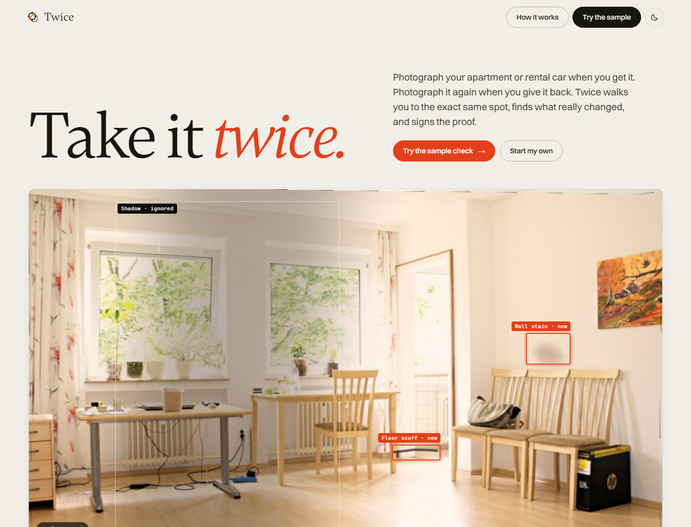
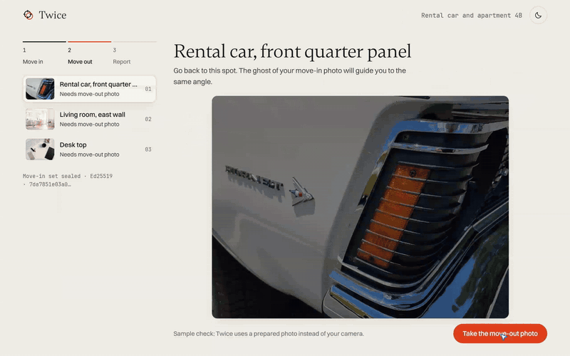
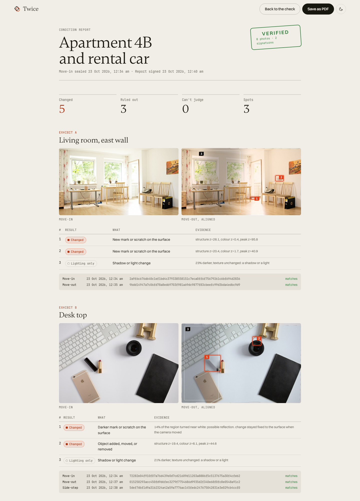

# Twice

**Take the same photo twice. See what really changed. Sign the proof.**

Twice is renter-side evidence for apartments and rental cars. You photograph a few spots when you move in. When you move out, Twice puts a ghost of each first photo over your camera and guides you back to the same angle. OpenCV 5 aligns the two photos, finds what changed, and rules out shadows, lamps and reflections. When it is unsure, the agent asks for one more photo. The result is a signed report that anyone can verify.

Built for the OpenCV AI Competition 2026. OpenCV 5 does all the image analysis. The evidence store, signing key, captioning model and metrics run on AWS.

**Live demo:** _the Function URL goes here after `deploy/deploy.sh` runs (see [deploy/README.md](deploy/README.md), "Before you submit")._

**Video (1 min 40 s):** [docs/video/twice-demo.mp4](docs/video/twice-demo.mp4). The source is a HyperFrames project in [video/twice-demo](video/twice-demo).



## Why

Rental companies now scan returned cars with AI. One Hertz renter received a $440 bill for a one-inch scuff: $250 damage, $125 processing and $65 administration ([The Drive](https://www.thedrive.com/news/this-is-what-happens-when-hertzs-ai-scanner-finds-damage-on-your-rental)). A House subcommittee chair wrote that Hertz is the only rental company that issues these damage assessments without human review, and asked Hertz for a briefing ([House Oversight](https://oversight.house.gov/release/mace-investigates-use-of-artificial-intelligence-for-car-rental-damage-assessments), [Repairer Driven News](https://www.repairerdrivennews.com/2025/08/25/subcommittee-requests-briefing-from-hertz-on-ai-scanning-technology/)). Landlords keep detailed move-out photos too. Most renters keep a few blurry phone shots that nobody can compare. Twice gives the renter the same quality of evidence as the company.

## What a judge can try in two minutes

1. Open the app and press **Try the sample check**. It loads three move-in photos (a rental car, a living room and a desk) and seals them on the spot, as a move-in day would.
2. Press **Take the move-out photo** on each spot. The sample uses prepared photos instead of your camera.
3. Watch the agent. On the car, a reflection looks like damage. The agent asks for a side-step photo, sees the reflection move, and rules it out. The scratch stays.

   

4. Press **Create the signed report**. The report shows every finding, every ruled-out shadow, the SHA-256 of every photo and two signatures. The stamp turns green only when the server re-hashes every stored photo and both signatures check out.
5. Press **Download evidence bundle**, unzip it, and run `python verify.py`. It checks every photo and both signatures without the Twice server.



A 46-second recording of the whole sample flow is in [docs/img/demo.mp4](docs/img/demo.mp4).

With a phone, press **Start my own** to run the same flow on your own room. On a laptop, use **Upload a photo** at each step.

## How it works


| Step | OpenCV 5 | What it does |
|---|---|---|
| Quality gate | `Laplacian`, `createCLAHE`, `SIFT` | The shutter waits until a move-in photo is sharp, lit and textured enough to match later. |
| Guide | `SIFT`, `findHomography` (`USAC_MAGSAC`) | Each live frame is matched to the move-in photo. The ghost overlay warps to the match, and the camera fires on its own after three aligned frames. |
| Register | `SIFT` + `FlannBasedMatcher`, `USAC_MAGSAC`, `warpPerspective`, `DISOpticalFlow` | The move-out photo is warped onto the move-in photo, then dense flow corrects the last few pixels. |
| Compare | `GaussianBlur`, local normalisation, `dilate`/`erode` envelopes, `connectedComponentsWithStats` | A structure and colour difference, scored as a robust z-score. Blur and exposure do not count as change. Follow-up photos use `dilate`/`erode` envelopes to tolerate a 1 px shift. |
| Decide | agent tools below | Every region gets a verdict: **Changed**, **Lighting only** or **Can't judge**. |
| Detect objects | `dnn.readNetFromONNX(..., engine=dnn.ENGINE_NEW)` with NanoDet-Plus | Labels a finding as "missing" or "new" when an object appears in only one photo. A person in the frame marks the finding as "can't judge". |

The agent is a rule planner with a budget of two follow-up photos per spot. Each tool result decides the next action, and the trace is shown in the app and stored in the report.


- `relight_check`: a smooth light field with no colour shift is a shadow or a lamp. Ruled out.
- `glare_check`: near-white pixels grew. The agent asks for a side-step photo. A reflection moves with the camera; damage stays on the surface.
- `parallax_check`: the homography of the side-step photo shows how far the camera moved. Under 1% of the frame, the photo cannot tell a reflection from damage, so the agent asks again. When no follow-ups are left, a person decides.
- `size_check`: a small, weak change gets a close-up request. The close-up is compared at higher resolution.
- `object_check`: NanoDet on the new DNN engine, as above.
- `caption`: Claude on Amazon Bedrock names each confirmed change. It can label a finding or hand it to a human. It cannot delete a finding. Without Bedrock, rule-based labels are used.

### Evidence

Every photo is hashed with SHA-256 on arrival. The move-in set is sealed with a signed manifest before any move-out photo exists. The final report is a second signed manifest over all photos, findings and agent traces. On AWS the signer is an asymmetric KMS key (ECDSA P-256), and the photos sit in an S3 bucket with Object Lock. `GET /api/checks/{id}/verify` re-hashes every stored file and checks both signatures against the published public key. The report also offers an evidence bundle: a zip with the photos, the seals, the public key and `verify.py`. Anyone can run `python verify.py` on it without the Twice server.

## Special awards

- **Agentic Vision with OpenCV 5:** [docs/agentic-vision.md](docs/agentic-vision.md) has the workflow diagram, a trace and a counterfactual trace in which only the visual evidence differs, and the evaluation of task success (754 of 850 benchmark runs), failure handling, observability and human control.
- **Best Use of COOL:** [docs/cool.md](docs/cool.md) and `deploy/cool/cool.py`. One command runs the Twice check on COOL on Graviton4, on pip OpenCV on the same instance, and on pip OpenCV on x86. It records evidence that COOL executed the workload and writes the results to `docs/eval/cool/`. A second command serves the app on COOL. The kit has not run on AWS yet, so this README claims no COOL numbers.

## Evaluation

The full method, ablations, latency and a failure gallery are in [docs/evaluation.md](docs/evaluation.md).

Three benchmarks cover the engine.

- **Synthetic, full agent loop** (`server/eval/agent_bench.py`, 170 pairs with known damage, camera moves, exposure, colour, shadow and glare, plus the follow-up shots the agent asks for): recall 0.88, precision 1.00, no false "changed" finding in 80 damage pairs. Recall counts a defect as found when a flagged box touches it; at engine level, recall drops from 0.91 to 0.70 when the box must also overlap the defect with an IoU of 0.3. Lighting-only pairs got a false alarm in 2% of cases. Every pair runs under 5 RANSAC seeds.
- **Real photos, nothing changed** (`server/eval/real_bench.py`, the Oxford affine sequences): of 40 pairs, 22 were judged. The agent asked for a retake on the other 18: 10 because the camera stood too far from the first spot, 8 because the photos could not be matched. Each sequence gets harder on purpose; the later viewpoint and zoom images go far beyond what the ghost guide lets through. None of the 22 judged pairs got a false alarm, including the light change, blur and JPEG series.
- **Hybrid, drawn defects on real photos** (`server/eval/hybrid_bench.py`, the 22 judged Oxford pairs, 370 defects from the synthetic generator drawn onto the move-out photo): recall 0.24, strict recall 0.16, precision 0.96. This is far below the 0.88 of the synthetic set, so treat 0.88 as an upper bound. Drawn defects are not real damage.

The first comparison uses a plain structure and colour difference. Follow-up photos, which move the camera on purpose, use a difference that tolerates a 1 px shift. The engine used the tolerant difference everywhere until all three benchmarks showed that the plain first pass gives far fewer false alarms (real photos: 2 of 22 judged pairs before, 0 now; hybrid precision 0.85 before, 0.96 now) for some loss in recall (hybrid 0.29 before, 0.24 now). A false damage finding hurts the renter the report is meant to protect, so the plain first pass stays. This choice was made after seeing the real and hybrid results.

All three bundled samples resolve to their ground truth, including the reflection on the car. There is no set of real move-in and move-out pairs with labelled damage yet. That is the most important limit of this evaluation.

NanoDet-Plus runs in a median of 16.3 ms per frame on `ENGINE_NEW` against 56.5 ms on `ENGINE_CLASSIC` on the same CPU. Reproduce with `cd server && python -m eval.engines`.

## Run it locally

Requirements: Python 3.12 or newer (tested with 3.12 in the Docker image and 3.14 in development), Node 24.

```bash
python -m venv .venv
.venv/bin/pip install -r server/requirements.txt        # Windows: .venv\Scripts\pip
cd server && ../.venv/bin/python -m uvicorn twice.app:app --port 8000
```

In a second shell:

```bash
cd web && npm ci && npx vite --port 5288
```

Open http://localhost:5288. Vite proxies `/api` to port 8000. Without AWS settings, photos go to `./data`, manifests are signed with a local Ed25519 key, and captions come from rules.

To run the production build in one container:

```bash
docker build -t twice .
docker run -p 8000:8000 twice
```

### Tests

```bash
cd server && ../.venv/bin/python -m pytest -q tests
python eval/synth.py <folder of photos> 40           # synthetic benchmark
python eval/bench.py                                  # engine level, see docs/evaluation.md
python eval/agent_bench.py                            # agent level, with follow-up photos
python eval/real_bench.py                             # real photos, false alarms only
```

The tests run the full sample flow through the API: seal, three move-out photos, follow-ups, signed report, verification, tamper tests that edit a stored photo or a signed record and expect verification to fail, and an offline check of the evidence bundle.

## Deploy to AWS

```bash
./deploy/deploy.sh
```

This builds an arm64 container for Lambda on Graviton behind a Function URL. The SAM template also creates the S3 evidence bucket (SSE-KMS, Object Lock, 30-day expiry), the KMS signing key, least-privilege IAM for Bedrock, a log group and an error alarm. Details and teardown steps: [deploy/README.md](deploy/README.md).

| Variable | Effect |
|---|---|
| `TWICE_BUCKET` | Store photos and manifests in this S3 bucket instead of `./data`. |
| `TWICE_KMS_KEY_ID` | Sign manifests with this KMS key (ECDSA_SHA_256) instead of a local Ed25519 key. |
| `TWICE_BEDROCK_REGION` | Caption confirmed findings with Claude on Bedrock in this region. |
| `TWICE_BEDROCK_MODEL` | Bedrock model ID. Default `anthropic.claude-opus-5-5`. |
| `TWICE_DATA` | Local storage folder when no bucket is set. |

## What is next

- **Real damage pairs.** The engine has not yet seen a real scratch. The first step is a small labelled set of real move-in and move-out pairs, photographed with the ghost guide, to replace the drawn defects in the hybrid benchmark.
- **The bundle as the product.** The evidence bundle is one zip that a renter can attach to a dispute email. A landlord, a rental company or an insurer can check it with `verify.py`, without an account and without trusting Twice. The first users are renters who are about to hand back a car or an apartment.
- **One more spot type.** The sample covers a car panel, a wall and a desk. A rental car has a fixed set of panels, so a car checklist (the four corners, the wheels and the windscreen) is the next guided flow. The Hertz bill above was for a wheel.

## Responsible use

- Twice sorts differences into three answers and never hides one. "Can't judge" is a real answer, and the report asks a person to review every "Changed" and "Can't judge" item.
- The language model only names changes. Geometry and measured evidence decide every verdict.
- The report states what it cannot prove: it covers only the photographed spots, the times come from the server clock, and a valid signature does not prove a photo shows what it claims.
- Photos expire from the bucket after 30 days by default. The app has no accounts and collects no personal data beyond the photos.
- The sample damage is synthetic. The sample photos are credited below.

## Repository

```
server/twice/      FastAPI app, OpenCV engine (vision.py), agent, detector, evidence, storage
server/eval/       synthetic benchmark and full evaluation
server/samples/    sample check generator and hero export
server/tests/      API flow and detector tests
web/               React app (Vite): landing, guided capture, results, report
deploy/            SAM template and deploy script; deploy/cool runs Twice on COOL (Graviton4)
docs/              spec, research, persona critique, evaluation, diagrams
```

## Credits

Sample photos via Wikimedia Commons: "Sunny Room in old Apartment" (CC BY 2.0), "Top Workspace Office" (CC0), "1970 AMC Hornet SST" (CC BY 4.0). NanoDet-Plus weights from [opencv_zoo](https://github.com/opencv/opencv_zoo) (Apache 2.0). Fonts: Gambetta and Switzer (Indian Type Foundry, ITF Free Font License), JetBrains Mono (OFL).
