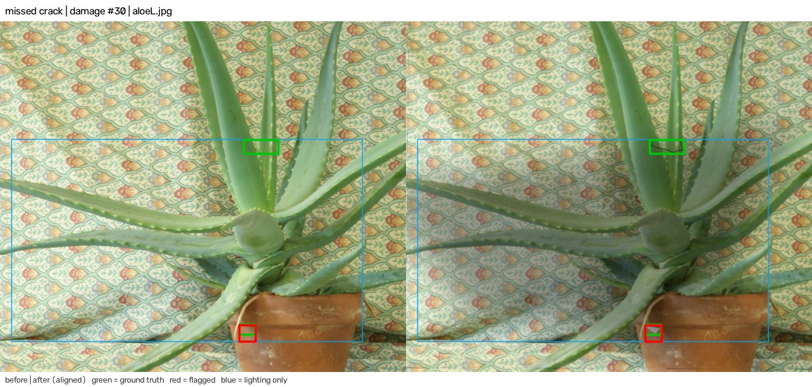
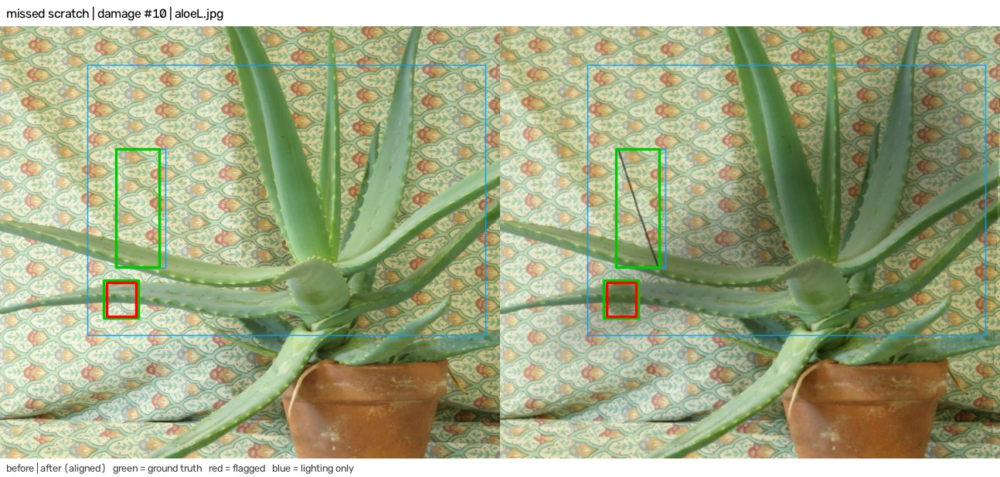
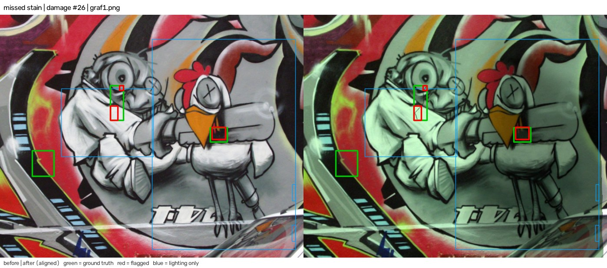
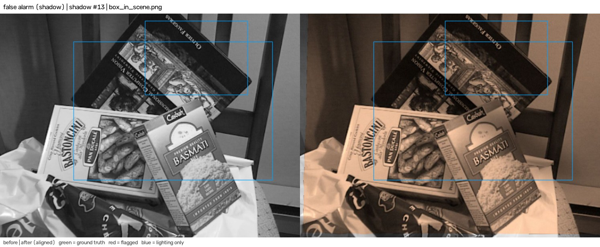
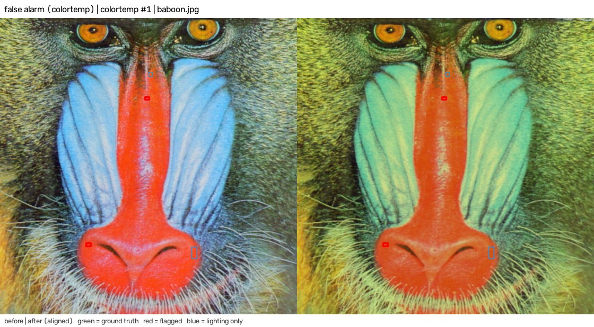
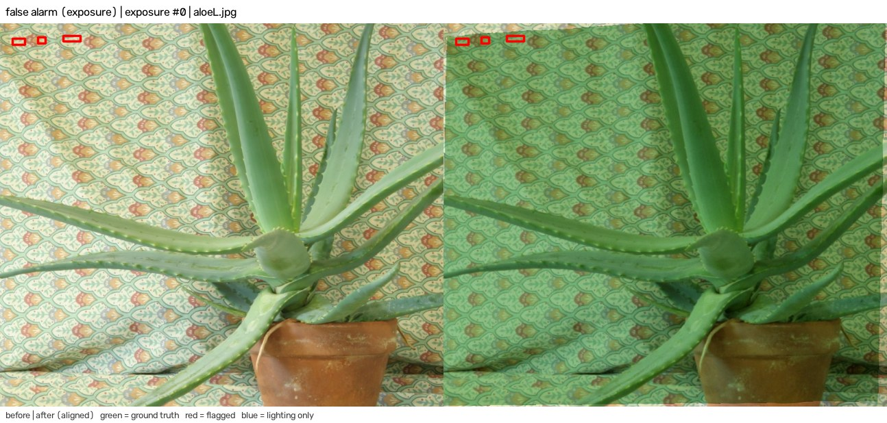

# Evaluation

This document reports how well the Twice change engine separates real damage from camera and lighting changes. All data is synthetic. No real phone photos were used. Section 9 lists what that means for the numbers.

Everything here comes from one script, `server/eval/bench.py`, with a fixed seed. The raw per-pair results are in `docs/eval/results.json`. The failure images are in `docs/eval/failures/`. The engine in `server/twice/` was not edited, tuned or retrained for this evaluation.

## 1. Summary

| Question | Result |
| --- | --- |
| Damage pairs (80 pairs, 162 defects): recall | 0.858 (139 of 162), 95% interval 0.796 to 0.903 |
| Damage pairs: precision | 0.880 (139 of 158 flagged regions), interval 0.820 to 0.922 |
| Damage pairs: false positives per pair | 0.24 (19 regions in 80 pairs) |
| Strict localisation: recall with box IoU of at least 0.3 | 0.679 (110 of 162) |
| No-change controls (30 pairs): share of pairs with any flag | 0.167 (5 of 30), interval 0.073 to 0.336 |
| Lighting-only controls (60 pairs): share of pairs with any non-lighting flag | 0.450 (27 of 60), interval 0.331 to 0.575 |
| Registration under rotation, scale, tilt | Reliable to 150 degrees of rotation, a 2.2 times scale change and 30 degrees of tilt. See section 5.4 |
| Latency, one before and after pair | Median 0.92 s, 95th percentile 1.25 s on a 32-thread CPU. Median 1.72 s on one thread |

The engine finds most defects and never failed to register in the damage and control sets. It does not yet meet the zero false alarm target. The worst case is a bright, veiling glare patch: all 15 specular pairs raised a false flag. Exposure changes raised false flags near the image border. A shadow test also hides real thin scratches and cracks. Sections 6 to 8 give the evidence.

## 2. Method

The benchmark generates a "move-in" image and a "move-out" image from the same source photo. It then compares them with `Keyframe.build` and `compare` from `server/twice/vision.py`. The code reuses the generators in `server/eval/synth.py` by import: `add_defect`, `add_shadow`, `camera`, `crop`, and `run`.

Every pair derives from the seed `[20260, set id, pair index]`. Any pair can be rebuilt from its index, so the failure gallery and the ablations see identical pairs. All ablations run on the same 170 pairs as the full engine, so differences between rows are paired differences.

Run it from `server/`:

```
python eval/bench.py <image folder> --out ../docs/eval
```

The full run took 907 s on the machine in section 5.5. It runs the ablations in 12 parallel worker processes. The latency test runs first, while the machine is otherwise idle.

## 3. Dataset construction

The ten source images are OpenCV sample images: aloeL, baboon, board, box_in_scene, building, fruits, graf1, home, lena and starry_night. Each one is resized to 1100 px wide. Several are small originals that the resize enlarges, so they are smoother than a phone photo.

The "before" image is the source scene with the 8% margin cropped off. The "after" image passes through `synth.camera`. That function applies a random perspective warp of up to 2% of the short side. It then applies a random per-channel gain from 0.75 to 1.2 in 70% of pairs and a brightness offset of up to 15 levels. It ends with Gaussian noise (sigma 3) and JPEG compression at quality 70 to 91. The camera model therefore adds some colour and exposure jitter to every set below.

| Set | Pairs | What changes between before and after |
| --- | --- | --- |
| Damage | 80 | 1 to 3 defects drawn on the scene (scratch, stain, chip, crack). A cast shadow is added to 39 of 80 pairs. Camera model on top |
| No change | 30 | Camera model only |
| Exposure | 15 | Global gain of 0.55 to 0.75 or 1.3 to 1.6, then camera model |
| Colour temperature | 15 | Blue and red gains moved in opposite directions by 15% to 25%, then camera model |
| Cast shadow | 15 | One soft convex shadow from `synth.add_shadow`, then camera model |
| Specular highlight | 15 | A Gaussian white blob, sigma 3% to 7% of the short side, blended towards white at 60% to 95%, then camera model |
| Registration stress | 288 | 4 transform types, 6 strengths, 12 pairs each. Described in section 5.4 |

The main sets hold 170 pairs. With the stress set, the benchmark scores 458 pairs. The 40-trial `synth.py` run is repeated as a reference and adds 40 more.

Defects are placed in the central 70% of the frame. The benchmark scores a defect by its ground-truth mask, which is the rendered defect layer above a threshold of 40 of 255.

## 4. Metrics

**Detection.** The engine returns regions. A region is "flagged" when its `lighting_only` property is false. The benchmark uses the same rule as `synth.py`:

- A ground-truth defect counts as found when at least one of its mask pixels lies inside any flagged box.
- A flagged box counts as a true positive when it contains at least one pixel of any defect mask.
- A flagged box that contains no defect pixel is a false positive.

Recall is found defects divided by all defects. Precision is true-positive boxes divided by all flagged boxes. When registration fails, every defect in that pair counts as missed. This never happened.

**This rule is lenient.** One overlapping pixel is enough, and one box can cover two defects. To measure this, the benchmark also reports strict recall. A defect counts only if its best matching box has an intersection over union (IoU) of at least 0.3. The IoU uses the tight bounding box of the defect mask. The median IoU of all matches is 0.62.

**Controls.** For the no-change and lighting-only sets, any flagged region is a false alarm, because no damage exists. The reported rate is the share of pairs with at least one flagged region. Regions that the engine labels `lighting_only` are not counted as flags.

**Intervals.** The 95% intervals are Wilson intervals on the pair or defect counts. They treat samples as independent. They do not cover the variation from the choice of ten source images.

**Size buckets.** Size is the area of the ground-truth mask in pixels: small below 150, medium 150 to 600, large above 600. Size and defect type overlap: all stains are large and all cracks are small or medium.

## 5. Results

### 5.1 Damage pairs, by defect type

| Defect | Count | Recall (synth rule) | Recall (IoU at least 0.3) |
| --- | --- | --- | --- |
| Scratch | 38 | 0.842 | 0.579 |
| Stain | 35 | 0.943 | 0.857 |
| Chip | 36 | 0.944 | 0.806 |
| Crack | 53 | 0.755 | 0.547 |
| All | 162 | 0.858 | 0.679 |

Cracks are one pixel wide and have the lowest recall. Scratches come second. The two thin defect types lose most of their strict recall to box size, not to misses.

### 5.2 Damage pairs, by size

| Size bucket | Count | Recall (synth rule) | Recall (IoU at least 0.3) |
| --- | --- | --- | --- |
| Small, under 150 px | 11 | 0.818 | 0.545 |
| Medium, 150 to 600 px | 95 | 0.821 | 0.600 |
| Large, over 600 px | 56 | 0.929 | 0.839 |

The small bucket holds only 11 defects, so its figure is weak. Two other splits matter. Recall is 0.824 in shadowed pairs (15 misses in 85 defects) and 0.896 in unshadowed pairs (8 in 77). The median contrast of a missed defect is 23 grey levels, against 50 for a found defect. Contrast is the mean absolute grey change over the mask, measured before the camera model and the shadow.

Recall and false positives by source image:

| Image | Defects | Recall | False positives |
| --- | --- | --- | --- |
| aloeL | 17 | 0.82 | 0 |
| baboon | 12 | 0.83 | 2 |
| board | 15 | 1.00 | 0 |
| box_in_scene | 18 | 0.78 | 8 |
| building | 17 | 0.82 | 6 |
| fruits | 16 | 0.81 | 1 |
| graf1 | 19 | 0.84 | 1 |
| home | 17 | 1.00 | 1 |
| lena | 14 | 0.71 | 0 |
| starry_night | 17 | 0.94 | 0 |

Two images, box_in_scene and building, produce 14 of the 19 false positives. Each image appears in 8 pairs, so these counts are small.

### 5.3 Control sets

| Set | Pairs | Pairs with a flag | Rate | Flags per pair | Registration failures |
| --- | --- | --- | --- | --- | --- |
| No change | 30 | 5 | 0.167 | 0.27 | 0 |
| Lighting only (all four types) | 60 | 27 | 0.450 | 0.95 | 0 |
| Exposure | 15 | 7 | 0.467 | 1.73 | 0 |
| Colour temperature | 15 | 3 | 0.200 | 0.27 | 0 |
| Cast shadow | 15 | 2 | 0.133 | 0.13 | 0 |
| Specular highlight | 15 | 15 | 1.000 | 1.67 | 0 |

The engine reports a separate lighting region in 14 of 15 shadow pairs and 11 of 15 exposure pairs. It does the same in 10 of 30 no-change pairs, which shows that the lighting label also appears where nothing changed.

In the damage set, 19 false-positive regions appear in 80 pairs. Four of them are in the 39 shadowed pairs.

### 5.4 Registration stress

The stress transform acts on the clean source image with only noise and JPEG added. The benchmark knows the true homography, so it can check accuracy. "Registered" means `vision.match` returned a homography. "Accurate" means the median error over a 7 by 7 grid of points is at most 3 px at 960 px width. "Usable" means `compare` also returned `ok`, which needs at least 30% overlap. Each cell uses 12 pairs.

Tilt is a camera pitch or yaw with a focal length equal to the image width. Scale zooms in or out with equal probability.

**Rotation (degrees in the image plane)**

| Strength | 5 | 15 | 30 | 60 | 90 | 150 |
| --- | --- | --- | --- | --- | --- | --- |
| Registered | 12/12 | 12/12 | 12/12 | 12/12 | 12/12 | 12/12 |
| Accurate | 12/12 | 12/12 | 12/12 | 12/12 | 12/12 | 12/12 |
| Usable | 12/12 | 12/12 | 12/12 | 12/12 | 12/12 | 12/12 |
| Median error (px) | 0.03 | 0.09 | 0.17 | 0.33 | 0.47 | 0.65 |

**Scale (zoom factor, in or out)**

| Strength | 1.1 | 1.3 | 1.7 | 2.2 | 3.0 | 4.5 |
| --- | --- | --- | --- | --- | --- | --- |
| Registered | 12/12 | 12/12 | 12/12 | 12/12 | 0/12 | 0/12 |
| Accurate | 12/12 | 12/12 | 12/12 | 12/12 | 0/12 | 0/12 |
| Usable | 12/12 | 12/12 | 12/12 | 4/12 | 0/12 | 0/12 |
| Median error (px) | 0.04 | 0.10 | 0.20 | 0.25 | none | none |

**Tilt (degrees)**

| Strength | 10 | 20 | 30 | 40 | 50 | 60 |
| --- | --- | --- | --- | --- | --- | --- |
| Registered | 12/12 | 12/12 | 12/12 | 7/12 | 2/12 | 0/12 |
| Accurate | 12/12 | 12/12 | 12/12 | 6/12 | 1/12 | 0/12 |
| Usable | 12/12 | 12/12 | 7/12 | 0/12 | 0/12 | 0/12 |
| Median error (px) | 0.03 | 0.03 | 0.04 | 0.05 | 0.14 | none |

**Combined** (rotation 3 to 60 degrees, zoom 1.05 to 2.2, tilt 3 to 45 degrees, rising together)

| Level | 0 | 1 | 2 | 3 | 4 | 5 |
| --- | --- | --- | --- | --- | --- | --- |
| Registered | 12/12 | 12/12 | 12/12 | 12/12 | 10/12 | 5/12 |
| Accurate | 12/12 | 12/12 | 12/12 | 12/12 | 9/12 | 5/12 |
| Usable | 12/12 | 12/12 | 12/12 | 9/12 | 0/12 | 0/12 |
| Median error (px) | 0.03 | 0.07 | 0.13 | 0.21 | 0.25 | 0.28 |

Two patterns stand out. First, "usable" falls before "registered" in the scale and tilt tests. The cause is the 30% overlap rule, not the matcher. A 2.2 times zoom in leaves about 21% of the view in common. Second, a registered pair was almost always accurate. The sub-pixel errors are optimistic, because the transform is an exact homography on a flat image. A real room has parallax.

### 5.5 Latency

Test machine: Intel Core i9-13900K, 32 logical threads, 63.7 GB RAM, Windows 11, Python 3.14.7, OpenCV 5.0.0. The timer covers `Keyframe.build` for both images plus `compare`. It excludes image decoding. `Keyframe.build` runs at its defaults: 1024 px longest side and 3000 SIFT features. The machine was idle during this test, after three warm-up pairs.

| Input | Threads | Build, one image (median) | Compare (median) | Total median | Total 95th percentile |
| --- | --- | --- | --- | --- | --- |
| 924 px wide benchmark pairs (30) | 32 | 126 ms | 683 ms | 0.92 s | 1.25 s |
| 4032 px wide pairs (12) | 32 | 136 ms | 756 ms | 1.04 s | 1.24 s |
| 924 px wide benchmark pairs (30) | 1 | 427 ms | 848 ms | 1.72 s | 3.20 s |
| 4032 px wide pairs (12) | 1 | 798 ms | 1192 ms | 2.83 s | 3.96 s |

The 4032 px inputs are the benchmark images enlarged with cubic interpolation. They test the cost of the resize, not the cost of real phone detail. A phone CPU will be slower than this desktop part. The one-thread row gives a rough upper bound for a single core of this machine, not for a phone.

## 6. Ablations

Each row switches off one engine step by replacing a function or object in the `twice.vision` module at run time. The engine files were not edited. The replacement is active only inside the run, and a call counter confirmed it for the two steps that needed a stand-in for `cv2`. Every row runs the same 170 pairs.

| Configuration | Change | Recall | Precision | FP per pair | No-change false alarm rate | Lighting-only false alarm rate | FPs in shadowed pairs |
| --- | --- | --- | --- | --- | --- | --- | --- |
| Full engine | none | 0.858 | 0.880 | 0.24 | 0.167 | 0.450 | 4 |
| Plain difference | `_tolerant_diff` replaced by `abs(a - b)` | 0.864 | 0.946 | 0.10 | 0.100 | 0.367 | 2 |
| No local normalisation | `_lnorm` returns its input | 0.210 | 1.000 | 0.00 | 0.000 | 0.250 | 0 |
| No flow refinement | DIS optical flow returns zero flow | 0.864 | 0.886 | 0.23 | 0.133 | 0.450 | 6 |
| No CLAHE | `_clahe.apply` returns its input | 0.858 | 0.863 | 0.28 | 0.167 | 0.450 | 6 |
| No clipped-pixel mask | the 7 by 7 dilation of the clipped mask returns zeros | 0.864 | 0.875 | 0.25 | 0.167 | 0.450 | 5 |
| No lighting test | `_illumination_likeness` returns 0 | 0.907 | 0.812 | 0.42 | 0.167 | 0.500 | 14 |
| Threshold z 6 (sensitivity, not an ablation) | `z_thresh=6` | 0.901 | 0.568 | 1.39 | 0.367 | 0.733 | 39 |
| Threshold z 12 (sensitivity, not an ablation) | `z_thresh=12` | 0.821 | 0.964 | 0.06 | 0.100 | 0.383 | 2 |

The default threshold is z 9.

**Not feasible without editing the engine.** The brightness gain map (`gain` in `compare`) and the 3 by 3 opening that removes noise specks are inline code. No function name or module attribute exposes them. The benchmark does not test them.

**How to read the table.** One defect is 0.006 of recall. One false positive is 0.0125 of FP per pair. Differences of one or two defects, or of two to three false positives, are within noise.

- **Local normalisation is essential.** Without it, recall falls to 0.210. The precision of 1.000 is meaningless, because the engine finds almost nothing.
- **The lighting test costs recall.** Switching it off recovers 8 defects (recall 0.858 to 0.907). It also raises false positives in shadowed pairs from 4 to 14. Section 8 shows what it hides.
- **The tolerant difference did not pay off here.** The plain difference matches recall (0.864 against 0.858) and has fewer false positives (0.10 against 0.24 per pair). The synthetic pairs have very little residual misalignment, so the tolerance has little to absorb. Real scenes with parallax may behave differently. This benchmark cannot show it.
- **Flow refinement, CLAHE and the clipped-pixel mask show no measurable effect.** The differences are within noise. The synthetic warps are exact homographies, and the glare blobs rarely saturate fully. These steps address problems that this dataset barely contains.
- **The threshold trades recall for precision smoothly.** Moving from z 12 to z 6 raises recall from 0.821 to 0.901 and cuts precision from 0.964 to 0.568.

## 7. Failure gallery

Each image shows the before frame on the left and the aligned after frame on the right. Green boxes are ground-truth defects. Red boxes are flagged regions. Blue boxes are regions the engine labelled lighting only. A found defect shows a red box over its green box.

### Missed defects



**Missed crack, aloeL pair 30.** A one-pixel dark crack on a leaf. The crack lies inside a region that the engine labelled as lighting. With the lighting test off, the crack is found.


**Missed chip, graf1 pair 16.** The chip has a contrast of only 11 grey levels against a light grey surface, so it is nearly invisible. The scratch and crack in the same pair were found with IoU above 0.97.



**Missed scratch, aloeL pair 10.** A clear dark line with a contrast of 86 grey levels, missed inside a shadowed area. The stain in the same pair was found. With the lighting test off, the scratch is found.



**Missed stain, graf1 pair 26.** A large stain with a contrast of 8 grey levels. The mean grey change is 8 levels, which is below the engine noise floor.

### False alarms


**Glare flagged as damage, aloeL specular pair 0.** The white veil removes colour from the green leaf. The chroma score is 13.9, above the 2.5 limit for lighting only, so the region is flagged.



**Border flag in a shadow pair, box_in_scene pair 13.** A 6 by 13 px region sits at x of 26 px, next to the excluded border band. Nothing in the scene changed there. This is a border effect, described in section 8.



**Two small flags after a colour shift, baboon pair 1.** The regions are 10 by 5 and 12 by 7 px on high-contrast fur and skin texture. A small texture mismatch survives the colour compensation.



**Border strips after an exposure change, aloeL pair 0.** Three flat strips lie along the top edge at y of 28 to 34 px, next to the excluded border band. Nothing in the scene changed there.

The gallery picks the first failure of each type, so it shows typical failures, not the worst ones.

## 8. Engine behaviour worth knowing

These observations come from the data above. I did not change the engine to test the explanations marked as hypotheses.

1. **The lighting test hides thin real defects inside shadows.** Of the 23 missed defects, 8 are found when `_illumination_likeness` is forced to 0. All 8 are scratches or cracks, and all 8 are in shadowed pairs (pairs 10, 28, 30, 35, 41, 56, 60 and 64). A thin dark line inside a region that darkened smoothly scores as lighting. The engine drops it with the shadow.
2. **Exposure changes cause border flags.** In the exposure set, 23 of 26 flags lie within 45 px of an image edge. In the no-change set, 7 of 8 flags do. In the damage set, 20 of 170 flags do, which matches defect placement. Hypothesis: the gain map blurs the after image with a 30 px Gaussian. Near the border, that blur mixes in pixels that the aligner copied unchanged from the before image. This would bias the gain estimate where it matters.
3. **Glare that removes colour looks like a stain.** All 15 specular pairs raised at least one flag. In several, the glare region had a chroma score from 5 to 18, far above the lighting limit of 2.5. In pair 13 (box_in_scene), the white blob produced 11 flags with chroma scores from 75 to 199. The clipped-pixel mask did not help, because the blob mixes towards white and rarely reaches 255.
4. **The lighting label also fires without lighting.** The engine reported a lighting region in 10 of 30 no-change pairs. Those pairs have camera gain jitter, so the label is not wrong. It does show that the label cannot tell a real shadow from a gain change.
5. **Registration is not the weak point.** It never failed in the 170 main pairs. In the stress test, it was stable to 150 degrees of rotation and 2.2 times scale. Large tilt breaks it first, then large scale change.
6. **The tolerant difference, flow step and CLAHE gave no measurable gain on this data.** See section 6.
7. **The earlier numbers reproduce.** The 40-trial `synth.py` run gives recall 0.912, precision 0.839, 0.35 false positives per pair and 3 false positives in shadow pairs, the same as before. The two recall values differ by 0.054. The 40-pair run holds roughly 80 defects (an estimate: about two per pair), so its 95% interval is about 0.83 to 0.96 and contains 0.858. The new estimate rests on 162 defects.

## 9. Limitations

- **The data is synthetic.** Defects are drawn shapes with fixed tones. Real scratches, stains and chips have texture, depth and soft edges. The engine may do better or worse on them.
- **There is no real photo set.** No pair comes from a phone. Real before and after photos differ in focus, autofocus hunting, white balance, rolling shutter, lens distortion, and a moved camera position. Registration error here is sub-pixel because the warp is an exact homography. Real rooms add parallax, so the tolerant difference and the flow step may matter more than this benchmark shows.
- **The scenes are few and small.** There are 10 source images, several enlarged from 512 px or less. Each one appears in 8 damage pairs. Results depend on those images. Box_in_scene and building alone supply most false positives.
- **The lighting model is simple.** Real shadows have hard edges and move across objects. Real glare is specular, follows surface shape, and often clips to pure white. Real colour shifts act per surface. The specular blob here is a soft white overlay, so a result of 15 of 15 flagged may overstate or understate the real rate.
- **The matching rule is lenient.** One overlapping pixel counts as a hit. Strict recall is 0.679 against 0.858. A report that says where the damage is should quote the strict figure.
- **No-change controls are not purely geometric.** They include the camera gain, offset, noise and JPEG model. A pure re-photograph without gain jitter was not run.
- **Statistical power is low in places.** The small-defect bucket has 11 defects. The control sets have 15 or 30 pairs, so a rate of 0.167 has an interval from 0.073 to 0.336. Ablation differences below about 0.02 in recall are noise.
- **The engine was not tuned on this set.** Its thresholds may have been set while developing against `synth.py` pairs, which share this generator. Treat this as a development benchmark, not a clean held-out test.
- **Latency is for a desktop CPU.** A phone or a small server will be slower. The 4032 px test uses enlarged images, not real detail.
- **No human evaluation.** The benchmark does not measure whether the reported regions, captions or signed report help a person.

What would change on real phones: expect more false alarms from glare and focus changes. Expect lower registration accuracy where parallax is present. Expect a different balance between recall on faint stains and false alarms on texture. The next step is a collected set of real move-in and move-out pairs with labelled damage.
