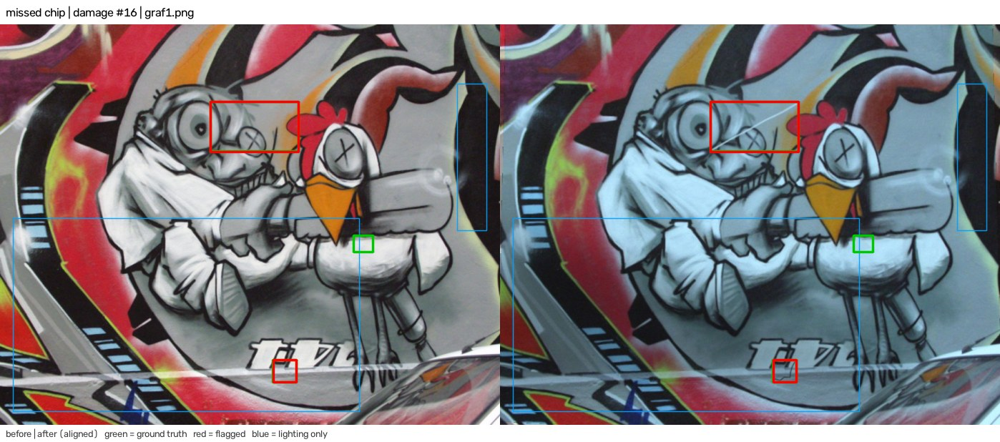
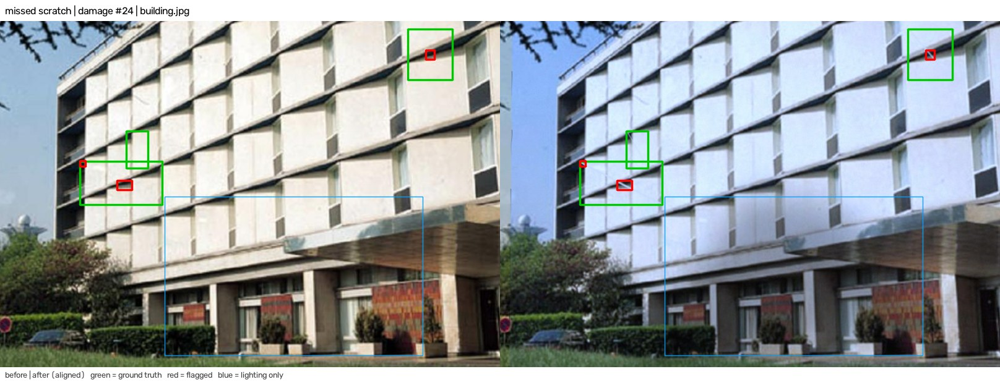
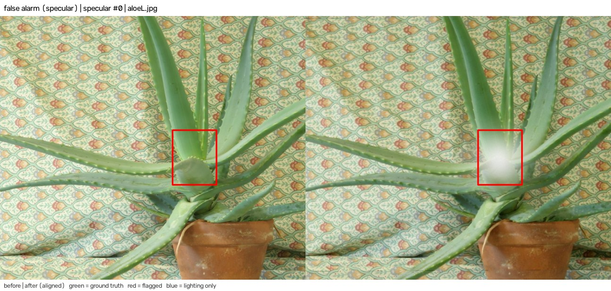
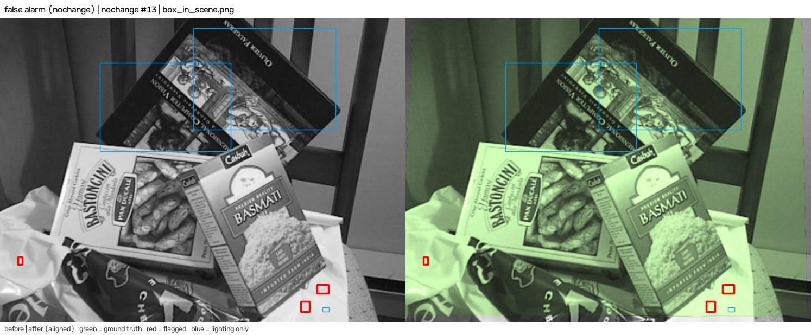
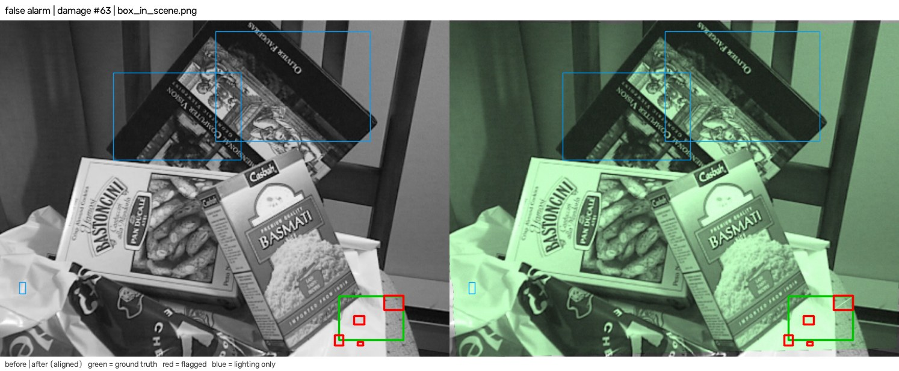
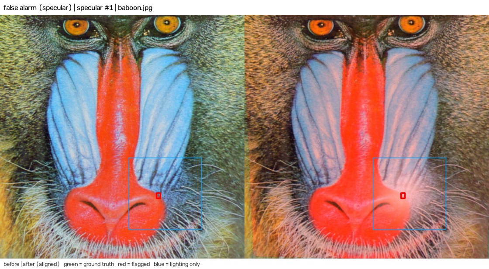

# Evaluation

This document reports how well Twice separates real damage from camera and lighting changes. Four benchmarks measure four levels:

- **Agent level** (`server/eval/agent_bench.py`): the full agent loop on 170 synthetic pairs, including the follow-up photos that the agent asks for. This is what a user gets.
- **Engine level** (`server/eval/bench.py`): the `compare` step alone on the same 170 pairs, plus registration stress, ablations, latency and the failure gallery.
- **Real photos** (`server/eval/real_bench.py`): 40 pairs of real photos from the Oxford affine sequences. Nothing in these scenes changes, so every "changed" verdict is a false alarm.
- **Hybrid** (`server/eval/hybrid_bench.py`): the 22 judged Oxford pairs again, with defects from the synthetic generator drawn onto the move-out photo. This measures recall on real texture. Section 7.1 gives the method.

There is no set of real move-in and move-out pairs with labelled damage. Section 11 lists what that means for the numbers.

The first comparison of a pair uses the plain difference. The follow-up photos (side-step shot and close-up) use a difference that tolerates a 1 px shift, because they move the camera on purpose. The agent, real photo and hybrid results made this choice, so those three sets are no longer fully untouched. Section 8 gives the reason.

The raw results are in `docs/eval/agent.json`, `docs/eval/results.json`, `docs/eval/real.json` and `docs/eval/hybrid.json`. The failure images are in `docs/eval/failures/`.

## 1. Summary

| Question | Result |
| --- | --- |
| Agent level, damage pairs (80 pairs, 162 defects): recall | Mean 0.878 over 5 seeds (142 of 162 under four seeds, 143 under one). For 142 of 162 the 95% interval is 0.817 to 0.919 |
| Agent level, damage pairs: precision | 1.000 (no false "changed" finding) for every seed. For 142 of 142 the interval is 0.974 to 1.000 |
| Agent level, no-change controls (30 pairs): pairs with a false "changed" | 1 of 30 (0.033) for every seed, interval 0.006 to 0.167 |
| Agent level, lighting-only controls (60 pairs): pairs with a false "changed" | Mean 0.023 over 5 seeds (1 or 2 of 60 per seed). For 2 of 60 the interval is 0.009 to 0.114 |
| Agent level, follow-up photos asked for | 0.20 per pair (side-step shots and close-ups) |
| Real photos, nothing changed (40 pairs) | 22 judged, 18 sent back for a retake. 0 of 22 judged pairs got a false "changed" (interval 0.000 to 0.149) |
| Hybrid, drawn defects on 22 real photo pairs (176 damage runs, 370 defects) | Recall 0.241 (89 of 370), strict recall 0.159, precision 0.957. With the tolerant difference in the first pass: 0.289, 0.178 and 0.849. See section 7.1 |
| Engine level, damage pairs: recall and precision | 0.907 and 0.993. Strict recall (box IoU of at least 0.3): 0.704 |
| Registration under rotation, scale, tilt | Accurate to 150 degrees of rotation, a 2.2 times scale change and 30 degrees of tilt. See section 5.4 |
| Latency, one before and after pair | Median 1.07 s, 95th percentile 1.25 s on a 32-thread CPU. Median 2.49 s on one thread. Upper bounds: other processes ran during the test |

The agent loop is the main result. The engine flags every glare patch. The agent then rules most of them out with a side-step photo or a veil test (section 6). On real photos, no judged pair got a false "changed". In the synthetic control sets, the agent still gives a false "changed" in one no-change pair, in one shadow pair under 2 seeds and in one glare pair under every seed.

The hybrid benchmark puts the same drawn defects on real photos. The agent finds 0.241 of them, against 0.878 on the synthetic pairs. The synthetic recall is therefore an upper bound for real texture.

The evaluation also drove engine changes. Section 9 lists each change with its before and after numbers. The plain first-pass difference costs recall: 0.289 to 0.241 in the hybrid set. It removes false alarms: 0.849 to 0.957 precision in the hybrid set and 2 to 0 false pairs in the real photos. The choice was made after the real and hybrid results were known (section 8).

## 2. Method

The synthetic benchmarks generate a "move-in" image and a "move-out" image from the same source photo. The engine benchmark compares them with `Keyframe.build` and `compare` from `server/twice/vision.py`. The agent benchmark runs `Agent.on_after` and then answers every follow-up request with a new synthetic photo (section 6). The code reuses the generators in `server/eval/synth.py` by import.

Every pair derives from the seed `[20260, set id, pair index]`. Any pair can be rebuilt from its index, so the failure gallery, the ablations and the agent benchmark see identical pairs. RANSAC draws random samples, so the agent benchmark runs every pair under 5 RANSAC seeds (`cv2.setRNGSeed` 0 to 4) and reports the pooled rate and the spread. All ablations run on the same 170 pairs as the full engine, so differences between rows are paired differences.

Run them from `server/`:

```
python eval/bench.py          # engine level, about 10 minutes
python eval/agent_bench.py    # agent level, 5 seeds, about 3 minutes
python eval/real_bench.py     # real photos, downloads the Oxford sequences on first run
python eval/hybrid_bench.py   # drawn defects on the real photos, about 3 minutes
```

The ten scenes are committed in `server/eval/scenes/`. A different folder can be passed to `bench.py` as the first argument. The engine benchmark runs the ablations in 12 parallel worker processes. The latency test runs first, before the worker processes start. The last full run took 581 s on the machine in section 5.5.

## 3. Dataset construction

The ten source images are OpenCV sample images: aloeL, baboon, board, box_in_scene, building, fruits, graf1, home, lena and starry_night. Each one is resized to 1100 px wide. Several are small originals that the resize enlarges, so they are smoother than a phone photo.

The "before" image is the source scene with the 8% margin cropped off. The "after" image passes through `synth.camera`. That function applies a random perspective warp of up to 2% of the short side. It then applies a random per-channel gain from 0.75 to 1.2 in 70% of pairs and a brightness offset of up to 15 levels. It ends with Gaussian noise (sigma 3) and JPEG compression at quality 70 to 91. The camera model therefore adds some colour and exposure jitter to every set below.

| Set | Pairs | What changes between before and after |
| --- | --- | --- |
| Damage | 80 | 1 to 3 defects drawn on the scene (scratch, stain, chip, crack). A cast shadow is added to 39 of 80 pairs. Camera model on top |
| No change | 30 | Camera model only |
| Exposure | 15 | Global gain of 0.55 to 0.75 or 1.3 to 1.6, then camera model |
| Colour temperature | 15 | Blue and red gains moved in opposite directions by 15% to 25%, then camera model |
| Cast shadow | 15 | One soft convex shadow from `synth.add_shadow`, then camera model |
| Specular highlight | 15 | A Gaussian white blob, sigma 3% to 7% of the short side, blended towards white at 60% to 95%, then camera model |
| Registration stress | 288 | 4 transform types, 6 strengths, 12 pairs each. Described in section 5.4 |

Defects are placed in the central 70% of the frame. The benchmark scores a defect by its ground-truth mask, which is the rendered defect layer above a threshold of 40 of 255.

## 4. Metrics

**Detection.** At engine level, a region is "flagged" when its `lighting_only` property is false. At agent level, a finding counts when its verdict is "changed". "Can't judge" findings do not count as found. Both levels use the same rule as `synth.py`:

- A ground-truth defect counts as found when at least one of its mask pixels lies inside any flagged box.
- A flagged box counts as a true positive when it contains at least one pixel of any defect mask.
- A flagged box that contains no defect pixel is a false positive.

Recall is found defects divided by all defects. Precision is true-positive boxes divided by all flagged boxes. When registration fails, every defect in that pair counts as missed. This never happened in the 170 main pairs.

**This rule is lenient.** One overlapping pixel is enough, and one box can cover two defects. The engine benchmark therefore also reports strict recall. A defect counts only if its best matching box has an intersection over union (IoU) of at least 0.3. The IoU uses the tight bounding box of the defect mask. The median IoU of all matches is 0.63.

**Controls.** For the no-change and lighting-only sets, any flagged region is a false alarm, because no damage exists. The reported rate is the share of pairs with at least one flagged region.

**Intervals.** The 95% intervals are Wilson intervals on the pair or defect counts. They treat samples as independent. They do not cover the variation from the choice of ten source images.

**Size buckets.** Size is the area of the ground-truth mask in pixels: small below 150, medium 150 to 600, large above 600. Size and defect type overlap: all stains are large and all cracks are small or medium.

## 5. Engine level

### 5.1 Damage pairs, by defect type

| Defect | Count | Recall (synth rule) | Recall (IoU at least 0.3) |
| --- | --- | --- | --- |
| Scratch | 38 | 0.947 | 0.658 |
| Stain | 35 | 0.886 | 0.743 |
| Chip | 36 | 0.944 | 0.778 |
| Crack | 53 | 0.868 | 0.660 |
| All | 162 | 0.907 | 0.704 |

Cracks are one pixel wide and have the lowest recall. The thin defect types lose most of their strict recall to box size, not to misses.

### 5.2 Damage pairs, by size and scene

| Size bucket | Count | Recall (synth rule) | Recall (IoU at least 0.3) |
| --- | --- | --- | --- |
| Small, under 150 px | 11 | 0.818 | 0.636 |
| Medium, 150 to 600 px | 95 | 0.905 | 0.653 |
| Large, over 600 px | 56 | 0.929 | 0.804 |

The small bucket holds only 11 defects, so its figure is weak. Recall is 0.918 in shadowed pairs (7 misses in 85 defects) and 0.896 in unshadowed pairs (8 in 77). The median contrast of a missed defect is 14 grey levels, against 51.5 for a found defect. Contrast is the mean absolute grey change over the mask, measured before the camera model and the shadow.

| Image | Defects | Recall | False positives |
| --- | --- | --- | --- |
| aloeL | 17 | 1.00 | 0 |
| baboon | 12 | 0.92 | 0 |
| board | 15 | 1.00 | 0 |
| box_in_scene | 18 | 0.78 | 1 |
| building | 17 | 0.82 | 0 |
| fruits | 16 | 0.88 | 0 |
| graf1 | 19 | 0.89 | 0 |
| home | 17 | 0.94 | 0 |
| lena | 14 | 0.86 | 0 |
| starry_night | 17 | 1.00 | 0 |

Box_in_scene produces the only false positive in the 80 damage pairs. Each image appears in 8 pairs, so these counts are small.

### 5.3 Control sets

| Set | Pairs | Pairs with a flag | Rate | Flags | Pairs with a lighting region |
| --- | --- | --- | --- | --- | --- |
| No change | 30 | 1 | 0.033 | 3 | 10 |
| Lighting only (all four types) | 60 | 15 | 0.250 | 16 | 40 |
| Exposure | 15 | 0 | 0.000 | 0 | 8 |
| Colour temperature | 15 | 0 | 0.000 | 0 | 5 |
| Cast shadow | 15 | 0 | 0.000 | 0 | 14 |
| Specular highlight | 15 | 15 | 1.000 | 16 | 13 |

At engine level, every glare patch raises a flag, and no other lighting set raises one. The engine marks the glare flag with a veil score, and the agent resolves it with a side-step photo (section 6). The lighting label also appears in 10 of 30 no-change pairs. Those pairs have camera gain jitter, so the label is not wrong, but it cannot tell a real shadow from a gain change.

### 5.4 Registration stress

The stress transform acts on the clean source image with only noise and JPEG added. The benchmark knows the true homography, so it can check accuracy. "Registered" means `vision.match` returned a homography. "Accurate" means the median error over a 7 by 7 grid of points is at most 3 px at 960 px width. "Usable" means `compare` judged the pair. It needs at least 30% overlap and, since the retake rule in section 9, a view close to the first one: at the centre and each corner, a local scale change between 0.8 and 1.25 and a stretch below 1.3. Each cell uses 12 pairs.

Tilt is a camera pitch or yaw with a focal length equal to the image width. Scale zooms in or out with equal probability.

**Rotation (degrees in the image plane)**

| Strength | 5 | 15 | 30 | 60 | 90 | 150 |
| --- | --- | --- | --- | --- | --- | --- |
| Registered | 12/12 | 12/12 | 12/12 | 12/12 | 12/12 | 12/12 |
| Accurate | 12/12 | 12/12 | 12/12 | 12/12 | 12/12 | 12/12 |
| Usable | 12/12 | 12/12 | 12/12 | 12/12 | 12/12 | 12/12 |
| Median error (px) | 0.03 | 0.09 | 0.17 | 0.33 | 0.47 | 0.65 |

**Scale (zoom factor, in or out)**

| Strength | 1.1 | 1.3 | 1.7 | 2.2 | 3.0 | 4.5 |
| --- | --- | --- | --- | --- | --- | --- |
| Registered | 12/12 | 12/12 | 12/12 | 12/12 | 0/12 | 0/12 |
| Accurate | 12/12 | 12/12 | 12/12 | 12/12 | 0/12 | 0/12 |
| Usable | 12/12 | 0/12 | 0/12 | 0/12 | 0/12 | 0/12 |
| Median error (px) | 0.04 | 0.10 | 0.17 | 0.26 | none | none |

**Tilt (degrees)**

| Strength | 10 | 20 | 30 | 40 | 50 | 60 |
| --- | --- | --- | --- | --- | --- | --- |
| Registered | 12/12 | 12/12 | 12/12 | 7/12 | 2/12 | 0/12 |
| Accurate | 12/12 | 12/12 | 12/12 | 6/12 | 1/12 | 0/12 |
| Usable | 12/12 | 1/12 | 0/12 | 0/12 | 0/12 | 0/12 |
| Median error (px) | 0.02 | 0.03 | 0.04 | 0.05 | 0.15 | none |

**Combined** (rotation 3 to 60 degrees, zoom 1.05 to 2.2, tilt 3 to 45 degrees, rising together)

| Level | 0 | 1 | 2 | 3 | 4 | 5 |
| --- | --- | --- | --- | --- | --- | --- |
| Registered | 12/12 | 12/12 | 12/12 | 12/12 | 10/12 | 5/12 |
| Accurate | 12/12 | 12/12 | 12/12 | 12/12 | 9/12 | 5/12 |
| Usable | 12/12 | 6/12 | 0/12 | 0/12 | 0/12 | 0/12 |
| Median error (px) | 0.03 | 0.07 | 0.13 | 0.21 | 0.24 | 0.28 |

The matcher is not the limit. It registers a 2.2 times zoom accurately. The retake rule refuses to judge that pair on purpose, because a photo from a different distance shows the surface at a different resolution. On real photos this difference caused false alarms (section 7). The rule also refuses a tilt of 20 degrees and the combined level 2 (15 degrees of rotation, 1.3 times zoom, 15 degrees of tilt). The ghost guide in the app locks to a far tighter view, within about 1.1 times scale, so a guided photo passes the rule. The rule also covers photos that were uploaded without the guide.

The sub-pixel errors are optimistic, because the transform is an exact homography on a flat image. A real room has parallax.

### 5.5 Latency

Test machine: Intel Core i9-13900K, 32 logical threads, Windows 11, Python 3.14.7, OpenCV 5.0.0. The timer covers `Keyframe.build` for both images plus `compare`. It excludes image decoding. `Keyframe.build` runs at its defaults: 1024 px longest side and 3000 SIFT features. The test ran after three warm-up pairs.

| Input | Threads | Build, one image (median) | Compare (median) | Total median | Total 95th percentile |
| --- | --- | --- | --- | --- | --- |
| 924 px wide benchmark pairs (30) | 32 | 117 ms | 840 ms | 1.07 s | 1.25 s |
| 4032 px wide pairs (12) | 32 | 156 ms | 1233 ms | 1.53 s | 2.31 s |
| 924 px wide benchmark pairs (30) | 1 | 556 ms | 1199 ms | 2.49 s | 3.76 s |
| 4032 px wide pairs (12) | 1 | 611 ms | 1190 ms | 2.55 s | 3.29 s |

The 4032 px inputs are the benchmark images enlarged with cubic interpolation. They test the cost of the resize, not the cost of real phone detail. The run inside `bench.py` overlapped with other work on the machine and gave a median of 1.50 s, so these figures come from a separate run of the latency step alone. The local dev server and a documentation agent still ran during it, so read them as upper bounds. The previous engine measured 0.87 s on an idle machine; the plain first pass does less work, so the change itself does not explain the difference. The object check adds NanoDet on `cv2.dnn.ENGINE_NEW`: a median of 16.3 ms per frame, against 56.5 ms on `ENGINE_CLASSIC` (`python -m eval.engines`). A second run gave 17.7 ms against 56.4 ms. The new engine is 3.2 to 3.5 times faster.

## 6. Agent level

The agent benchmark runs the same 170 pairs through `Agent.on_after`. When the agent asks for a follow-up photo, the benchmark makes one:

- **Side-step shot.** A new camera position of the same scene with a larger warp (3.5% of the short side). In a glare pair, the glare patch moves to a new place on the surface, as a reflection does when the camera moves. Damage stays where it is.
- **Close-up.** A crop around the requested box, enlarged two times, with a small perspective jitter, a gain change, noise and JPEG.

The table pools the 5 seeds, so each set has 5 runs per pair.

| Set | Pair runs | Runs with a false "changed" | Side-step shots | Close-ups | "Can't judge" findings |
| --- | --- | --- | --- | --- | --- |
| Damage | 400 | 0 | 52 | 42 | 17 |
| No change | 150 | 5 (1 per seed) | 0 | 5 | 0 |
| Exposure | 75 | 0 | 0 | 0 | 0 |
| Colour temperature | 75 | 0 | 0 | 0 | 0 |
| Cast shadow | 75 | 2 (seeds 1 and 2) | 0 | 0 | 0 |
| Specular highlight | 75 | 5 (1 per seed) | 70 | 5 | 0 |

Precision is 1.000 under every seed. Recall is 0.877 under four seeds and 0.883 under one (142 and 143 found defects). The agent ends 0.02 findings per pair as "Can't judge". They count as misses in the recall figure. Two figures move between seeds: the lighting-only rate, from 1 to 2 of 60 pairs, and the count of found defects, from 142 to 143.

The agent loses five defects against the engine (142 against 147 found). The engine has 1 false positive in the 80 damage pairs, and the agent has none. Glare is the clearest case. The engine flags all 15 glare pairs, and the agent asks for a side-step shot in 70 of 75 runs. The bright patch moves or vanishes, and the finding becomes "Lighting only". In the other 5 runs the glare ends as a false "changed". These 5 runs are building pair 4 under each seed. The agent asks for no follow-up photo there. The veil test (section 9) sends lightened regions to the same follow-up.

The agent missed the same 19 defects under every seed: 8 cracks, 7 stains, 2 scratches and 2 chips. 17 of the 19 have a contrast below 25 grey levels. A 20th defect, a scratch in building pair 24, was missed under four seeds and found under one.

## 7. Real photos

The Oxford affine sequences (Mikolajczyk et al.) photograph one scene six times with growing difficulty. Nothing in the scene changes on purpose. The benchmark compares image 1 with images 2 to 6 through the full agent, so every "changed" verdict is a false alarm. It does not answer follow-up requests, so a follow-up request ends the pair without a "changed" verdict.

| Sequence | Stress | Judged (of 5) | Pairs with a false "changed" |
| --- | --- | --- | --- |
| leuven | light | 5 | 0 |
| bikes | blur | 5 | 0 |
| trees | blur | 4 | 0 |
| ubc | JPEG | 5 | 0 |
| graf | viewpoint | 0 | 0 |
| wall | viewpoint | 1 | 0 |
| boat | zoom and rotation | 1 | 0 |
| bark | zoom and rotation | 1 | 0 |
| All | | 22 of 40 | 0 (interval 0.000 to 0.149) |

The agent asked for a retake on 18 pairs. In 10, the camera stood too far from the first position for a fair comparison (the retake rule). In 8, the photos could not be matched at all. The agent asked for a follow-up photo on 9 judged pairs, mostly in the blur sequences.

Two earlier engine states gave false "changed" verdicts here. Before the retake rule, 32 pairs were judged and 7 got a false "changed": trees 1-5, graf 1-4, wall 1-3, 1-4 and 1-5, and boat 1-2 and 1-3. The wall and graf pairs had a scale change of 1.2 to 1.7 and a strong tilt. The rule removed 5 of the 7. It also refuses graf 1-2, a viewpoint change of about 20 degrees. The two that remained were trees 1-5 and boat 1-2. They came with the tolerant difference in the first pass. The plain difference removed both, and no judged pair now gets a false "changed".

No sequence gives a false "changed". That includes the light change (leuven), the JPEG series (ubc) and the blur series (bikes). These are the three stresses that a re-photographed apartment meets most often. A rate of 0 of 22 still has an upper bound of 0.149, and the benchmark does not answer follow-up requests.

### 7.1 Hybrid: drawn defects on real photos

The benchmark above has no damage, so it measures false alarms only. The hybrid benchmark (`server/eval/hybrid_bench.py`) adds damage to the same photos. It answers one question: how many drawn defects does the agent find when the texture, blur, noise and light of the photo are real?

**Method**

- **Pairs.** The 22 pairs that section 7 judged. The 18 retake pairs are left out.
- **Defects.** The generator in `synth.py` (`add_defect` for scratch, stain, chip and crack, and `add_shadow`) draws in the frame of image 1. The benchmark draws 1 to 3 defects per run and a cast shadow in half of the runs, as in the synthetic damage set. It projects the drawn layer into the move-out photo with the ground-truth homography of the sequence (the `H1to*p` files). A defect must lie fully inside the move-out photo, so the benchmark redraws the position until it does. The mask in the frame of image 1 is the ground truth.
- **Nothing else is simulated.** The move-out photo keeps its own blur, noise, compression, light and viewpoint. The synthetic camera model is not applied.
- **Runs.** Each pair gets 8 damage draws (176 runs, 370 defects). It also gets 3 shadow-only draws, 3 glare-only draws and 3 runs with nothing drawn (66 runs of each). Each run sets `cv2.setRNGSeed` to its draw number.
- **Follow-up photos.** The side-step shot is another real photo of the same sequence: the nearest judged one, or the nearest one if no other was judged. The same layers are projected into it. For a glare run, a new glare patch is drawn at a new place, as in `agent_bench.py`. The close-up is a crop of the real move-out photo around the box, enlarged two times, with the jitter, gain, noise and JPEG step of `agent_bench.py`. A side-step photo that does not register leaves the finding as "Can't judge".
- **Scoring.** The agent-level rules of section 4. A defect is found when a "changed" box touches it. Strict recall also needs an IoU of at least 0.3 between the tight box of the defect and the best box that touches it. Precision is found defects divided by found defects plus "changed" boxes that touch no defect.
- **Ablation.** The tolerant-first-pass configuration of section 8 (the engine before the switch to the plain difference) runs the same jobs under the same seeds, through the full agent.

The run takes 181 s on the machine in section 5.5, with 12 worker processes.

**Result**

| Measure | Full engine | Tolerant first pass |
| --- | --- | --- |
| Damage runs, defects | 176, 370 | 176, 370 |
| Recall (a box touches the defect) | 0.241 (89 of 370) | 0.289 (107 of 370) |
| Strict recall (IoU at least 0.3) | 0.159 (59 of 370) | 0.178 (66 of 370) |
| Precision | 0.957 (89 of 93) | 0.849 (107 of 126) |
| False "changed" findings per damage run | 0.02 (4) | 0.11 (19) |
| Runs with a false "changed", nothing drawn | 0.045 (3 of 66) | 0.136 (9 of 66) |
| Runs with a false "changed", shadow only | 0.015 (1 of 66) | 0.076 (5 of 66) |
| Runs with a false "changed", glare only | 0.030 (2 of 66) | 0.091 (6 of 66) |
| "Can't judge" findings per run, all sets | 0.33 | 0.45 |
| Follow-up photos per run, all sets | 0.60 | 0.68 |
| Runs that ended in a retake request | 0 | 0 |

Recall by defect type for the full engine: scratch 0.312 (34 of 109), stain 0.192 (19 of 99), chip 0.370 (27 of 73), crack 0.101 (9 of 89).

| Sequence | Stress | Pairs | Defects | Found | Found, strict | False "changed" findings |
| --- | --- | --- | --- | --- | --- | --- |
| leuven | light | 5 | 74 | 18 | 12 | 0 |
| bikes | blur | 5 | 93 | 35 | 24 | 0 |
| trees | blur | 4 | 71 | 0 | 0 | 4 |
| ubc | JPEG | 5 | 85 | 25 | 12 | 0 |
| wall | viewpoint | 1 | 13 | 7 | 7 | 0 |
| boat | zoom and rotation | 1 | 19 | 3 | 3 | 0 |
| bark | zoom and rotation | 1 | 15 | 1 | 1 | 0 |
| All | | 22 | 370 | 89 | 59 | 4 |

**What it shows**

- **Recall on real texture is far lower than on the synthetic set.** The full agent finds 0.241 of the drawn defects, against 0.878 on the synthetic pairs. Strict recall is 0.159. The 95% interval for recall is 0.200 to 0.287 if the defects were independent. They are not: the 370 defects come from 22 pairs, so the true interval is wider.
- **Recall falls as the stress grows inside a sequence.** In bikes, the agent finds 14 of 19 defects in pair 1-2 and 4 of 18 in pair 1-6. In ubc it finds 12 of 16 in pair 1-2 and none of 17 in pair 1-6. The wall pair (13 defects) gives 7 of 13.
- **Trees is the worst case.** The agent finds none of the 71 defects in the four trees pairs, and it adds 4 false "changed" findings. The leaf texture probably raises the noise level of the change map above thin defects. This was not tested.
- **Registration error is not the main cause.** In a one-off check on pair 1-2 of leuven, bikes, ubc and trees, the estimated homography differed from the ground truth by 0.03 to 0.55 px at the median. Flagged boxes that overlap a defect lie at its drawn position.
- **Many findings end as "Can't judge".** The damage runs have 70 such findings, 0.40 per run. They count as misses.
- **The control runs differ from section 7 on follow-ups.** Section 7 does not answer follow-up requests, and the hybrid runs do. The runs with nothing drawn give a false "changed" in 3 of 66 runs, all in trees. Shadow-only runs fail once, in trees. Glare-only runs fail twice, once in bikes and once in wall. Glare-only runs asked for 36 side-step photos in 66 runs.
- **The plain difference is less sensitive and more precise here.** It finds 89 defects against 107 and adds 4 false "changed" findings against 19. Boat gives 11 false findings with the tolerant difference and none with the plain one. On the synthetic set, the two differences had nearly the same recall. The Oxford scenes are mostly flat or far away, so they have little parallax. The plain difference is therefore the first-pass choice (section 8). The tolerant difference finds more defects on real texture and costs false alarms. The choice was made after seeing these results, so this set is no longer untouched.

**Limits**

- **Drawn defects are not real damage.** They have fixed tones and sharp edges. They are not blurred or compressed with the photo, so they look cleaner than real damage in the blur and JPEG sequences. A real scratch has depth and a real stain has texture.
- **The scenes are not rooms.** The set is 7 sequences of buildings, trees, a harbour and bark. The 22 pairs share 7 scenes, and the 8 draws of one pair share a background.
- **The mix follows what registers.** Bikes, leuven and ubc supply 15 of the 22 pairs. Wall, boat and bark have one pair each. The 18 retake pairs are excluded, so the figures describe only the pairs the agent agrees to judge.
- **Follow-up photos are partly simulated.** The side-step photo is real, but the close-up is a crop of the move-out photo. A glare patch moves by construction.
- **One decision came from this benchmark.** The plain difference in the first pass (section 8) was chosen after the hybrid and real results. No threshold was changed. One tuning attempt was rejected and is described below.

**A tuning attempt that was rejected**

This block was measured on the previous engine, which used the tolerant difference in the first pass. A diagnosis of the 261 missed defects in its runs found three causes:

- In 164 of the misses, the z-score inside the defect stays under 9. The noise scale of the photo is high, or the defect is dark on a dark surface (leuven 1-6).
- In 43 of the misses, the 3 × 3 opening or the speck filter erases a thin line.
- The other misses are lost later or lie outside the valid area.

Three changes were tuned on leuven, bikes, wall and bark:

- a noise scale for each tile of the photo;
- a z-score for the brightness difference;
- a 2 × 2 opening.

Together they raised recall on those sequences from 0.40 to 0.45. On the held-out sequences (ubc, trees, boat), recall rose from 0.17 to 0.35. False "changed" findings per damage run rose from 0.24 to 0.76, and precision fell from 0.60 to 0.50. A false damage finding hurts the renter that the report is meant to protect, so the changes were not kept. These figures describe the previous engine. The current figures above come from the engine without these changes.

## 8. Ablations

Each row switches off one engine step by replacing a function or object in the `twice.vision` module at run time. The engine files are not edited. Every row runs the same 170 pairs at engine level.

| Configuration | Change | Recall | Precision | FP per pair | No-change false alarm rate | Lighting-only false alarm rate | FPs in shadowed pairs |
| --- | --- | --- | --- | --- | --- | --- | --- |
| Full engine (plain difference in the first pass) | none | 0.907 | 0.993 | 0.01 | 0.033 | 0.250 | 0 |
| Tolerant difference in the first pass | `_tolerant_diff` always uses a 1 px shift | 0.914 | 0.931 | 0.14 | 0.100 | 0.333 | 4 |
| No local normalisation | `_lnorm` returns its input | 0.247 | 0.976 | 0.01 | 0.000 | 0.267 | 1 |
| No flow refinement | DIS optical flow returns zero flow | 0.914 | 1.000 | 0.00 | 0.033 | 0.250 | 0 |
| No CLAHE | `_clahe.apply` returns its input | 0.914 | 0.980 | 0.04 | 0.033 | 0.267 | 2 |
| No clipped-pixel mask | the 7 by 7 dilation of the clipped mask returns zeros | 0.914 | 1.000 | 0.00 | 0.033 | 0.267 | 0 |
| No lighting test | `_illumination_likeness` returns 0 | 0.914 | 0.987 | 0.03 | 0.033 | 0.267 | 0 |
| Threshold z 6 (sensitivity, not an ablation) | `z_thresh=6` | 0.957 | 0.852 | 0.34 | 0.100 | 0.350 | 7 |
| Threshold z 12 (sensitivity, not an ablation) | `z_thresh=12` | 0.840 | 1.000 | 0.00 | 0.033 | 0.217 | 0 |

The default threshold is z 9. One defect is 0.006 of recall. One false positive is 0.0125 of FP per pair. Differences of one or two defects, or of two to three false positives, are within noise.

- **Local normalisation is essential.** Without it, recall falls to 0.247.
- **The lighting test no longer costs recall.** In the first evaluation, switching it off recovered 8 thin defects inside shadows. With the sharp-edge test from section 9, the gap is one defect: recall is 0.914 without the test and 0.907 with it. False positives per pair are 0.03 without it and 0.01 with it. Both gaps are within noise.
- **The plain difference is the first-pass choice.** The tolerant difference has nearly the same recall on the synthetic data (0.914 against 0.907) and many more false positives (0.14 per pair against 0.01). The agent, real and hybrid benchmarks all showed fewer false alarms with the plain difference, for a loss in recall. At agent level, recall went from 0.901 to 0.878 and precision from 0.993 to 1.000. On real photos, false "changed" pairs went from 2 to 0. In the hybrid set, recall went from 0.289 to 0.241 and precision from 0.849 to 0.957. Section 9 lists the two changes behind the agent figures. A false damage finding costs the renter more than a missed faint defect, so the plain difference was kept. The decision was made after seeing the hybrid and real results, so those sets are no longer fully untouched. A labelled real set would test it.
- **The follow-ups keep the tolerance.** A side-step shot and a close-up move the camera on purpose, so they carry more misalignment. With the plain difference in the follow-ups too, the parallax check on the sample car broke: the misalignment of the side-step photo made the reflection look fixed to the surface. The follow-ups therefore use the tolerant difference with a 1 px shift. The benchmarks do not measure this case.
- **Flow refinement, CLAHE and the clipped-pixel mask show no clear effect.** The differences are within noise. These steps address problems that this dataset barely contains.
- **The threshold trades recall for precision smoothly.** Moving from z 12 to z 6 raises recall from 0.840 to 0.957 and cuts precision from 1.000 to 0.852.

## 9. What the evaluation changed

The evaluation exposed faults in the engine. The changes below fix them. The results above use the fixed engine.

| Change | Problem it fixes |
| --- | --- |
| Exposure-matched border fill | Pixels outside the warped photo were filled from the move-in photo without an exposure match, so exposure changes made strips along the border |
| Sharp-edge test for lighting | The lighting test hid thin dark lines inside shadows. A shadow changes brightness smoothly and a scratch has a sharp edge, so a region with a sharp residual no longer counts as lighting |
| Chroma noise floor | Near-grey regions had a tiny chroma spread, so a small colour change scored very high |
| Veil test | Glare lifts a surface towards white in proportion to its distance from white. The test fits this model and sends a good fit to the side-step follow-up |
| Retake rule (`_same_view`) | A move-out photo from a different distance or angle shows the surface at a different resolution, and texture then reads as change. The rule checks the local scale and stretch at the centre and the four corners, so a strong tilt fails too |
| Plain difference in the first pass (`compare(..., shift=0)`) | The tolerant difference raised false alarms on real texture and on shadowed or colour-shifted synthetic pairs. The first comparison now uses the plain difference. Side-step shots and close-ups keep the 1 px tolerance (`shift=1`), because they move the camera on purpose. The plain difference there broke the parallax check on the sample car |
| Clipped pixels count as near-white (`_brightening`) | A pixel that clips in the move-out photo (value above 253) now counts as near-white whatever the local gain. Before, the reflection verdict on the sample car depended on the RANSAC seed |

The first four changes were measured together on the same pairs. The "After" column is the engine at that time, with the tolerant first pass. The "Now" column is the current engine, with the plain first pass and the clipped-pixel fix:

| Level | Metric | Before | After | Now |
| --- | --- | --- | --- | --- |
| Engine | Recall | 0.858 | 0.914 | 0.907 |
| Engine | Precision | 0.880 | 0.931 | 0.993 |
| Engine | Exposure pairs with a flag | 7 of 15 | 1 of 15 | 0 of 15 |
| Engine | No-change pairs with a flag | 5 of 30 | 3 of 30 | 1 of 30 |
| Agent | Recall | 0.852 | 0.901 | 0.878 |
| Agent | Precision | 0.972 | 0.993 | 1.000 |
| Agent | Lighting-only pairs with a false "changed" | 0.30 | 0.033 | 0.023 |

The "Before" and "After" numbers use one RANSAC seed per pair, from before the seeded runs. The "Now" numbers are from the 5-seed agent run.

The retake rule was measured alone. It cut the real-photo pairs with a false "changed" from 7 to 2. On the synthetic agent benchmark, recall, precision and the no-change rate stayed the same.

The plain first pass and the clipped-pixel fix were measured together, against the run before them. Real-photo pairs with a false "changed" fell from 2 to 0. Agent-level recall fell from 0.901 to 0.878, and precision rose from 0.993 to 1.000. In the hybrid set, recall fell from 0.289 to 0.241 and precision rose from 0.849 to 0.957. Section 8 gives the reason for the plain first pass.

One experiment failed. Matching the sharpness of the two photos before the difference gave 8 false pairs on real photos and broke the glare check on the car sample. It was reverted.

## 10. Failure gallery

Each image shows the before frame on the left and the aligned after frame on the right. Green boxes are ground-truth defects. Red boxes are flagged regions. Blue boxes are regions the engine labelled lighting only. A found defect shows a red box over its green box. The gallery shows engine-level output. It picks the first failure of each type, then fills the remaining places with the next failures in order. It shows typical failures, not the worst ones. With the plain first pass, the engine has few false alarms. Only the damage, no-change and glare sets have any, so the gallery holds the first false alarm of each of these sets and a second glare pair.

### Missed defects


**Missed stain, graf1 pair 26.** A large stain with a contrast of 8 grey levels, which is below the engine noise floor. The other two defects in the pair were found. The agent also misses it.



**Missed chip, graf1 pair 16.** The chip has a contrast of only 11 grey levels against a light grey surface, so it is nearly invisible. The other two defects in the pair were found. The agent also misses it.


**Missed crack, baboon pair 31.** A thin crack in fur, after a colour shift. The engine flags nothing in this pair. The crack lies inside a large region that the engine labelled as lighting, because the whole fur area changed colour smoothly. The agent has no finding to follow up, so it misses the crack too.



**Missed scratch, building pair 24.** The after photo is much brighter, and the scratch sits on a pale wall panel whose contrast the brightening flattens. The two other scratches in the pair were found, but only as small boxes inside the drawn boxes, so strict recall does not count them. The agent misses the same scratch under four of five seeds.

### False alarms



**Glare flagged at engine level, aloeL specular pair 0.** The white veil removes colour from the green leaf, so the chroma score is 14.9. The agent resolves this pair: it asks for a side-step shot and a close-up, and no "changed" finding remains.



**Three small flags in a no-change pair, box_in_scene pair 13.** The regions are 16 by 21, 23 by 17 and 7 by 15 px, with structure scores of 11 to 14. The after photo has a strong green cast. Nothing in the scene changed. This is the only no-change pair with a flag at engine level. The agent asks for a close-up and still reports two false "changed" findings, under every seed. This is the no-change false alarm in the agent-level count.



**Four small flags around one scratch, box_in_scene pair 63.** The scratch has a contrast of 14 grey levels. One of the four flags touches no defect pixel. It is the only false positive in the 80 damage pairs. The agent asks for one or two close-ups and ends with no false "changed" finding.



**One small flag in a glare pair, baboon specular pair 1.** The flag is 12 by 15 px and lies inside the lighting region of the glare patch. The agent asks for a side-step shot and removes it.

## 11. Limitations

- **There is no labelled real damage.** The synthetic defects are drawn shapes with fixed tones. Real scratches, stains and chips have texture, depth and soft edges. The real-photo benchmark measures false alarms only. The hybrid benchmark draws the same defects on real photos, and drawn defects are not real damage either.
- **The synthetic follow-up photos are simple.** The side-step shot is a larger warp of the same flat image, and glare moves by construction. A real reflection moves with surface shape and camera position. The agent results for glare are therefore optimistic.
- **The real set is small and not a room.** The Oxford sequences are 8 scenes and 40 pairs. They include blur, JPEG, light and viewpoint stress, but no wall, floor or car panel.
- **The scenes are few and small.** There are 10 synthetic source images, several enlarged from 512 px or less. Each one appears in 8 damage pairs.
- **The matching rule is lenient.** One overlapping pixel counts as a hit. Strict recall at engine level is 0.704 against 0.907. A report that says where the damage is should quote the strict figure.
- **Statistical power is low in places.** The small-defect bucket has 11 defects. The control sets have 15 or 30 pairs, so a rate of 0.033 has an interval up to 0.167. The real set has 22 judged pairs, so a rate of 0 has an upper bound of 0.149.
- **The engine was tuned on this generator.** The fixes in section 9 were measured on these pairs. Treat the synthetic numbers as a development benchmark, not a clean held-out test. The choice of the plain difference for the first pass used the agent, real and hybrid results (section 8), so none of the three is a clean held-out test either. Apart from that choice and the retake rule, which uses the guide's own limits, no threshold was tuned on the real-photo numbers, hybrid included.
- **Latency is for a desktop CPU.** A phone or a small server will be slower.
- **No human evaluation.** The benchmark does not measure whether the reported regions, captions or signed report help a person.

The next step is a collected set of real move-in and move-out pairs with labelled damage, photographed with the ghost guide.
