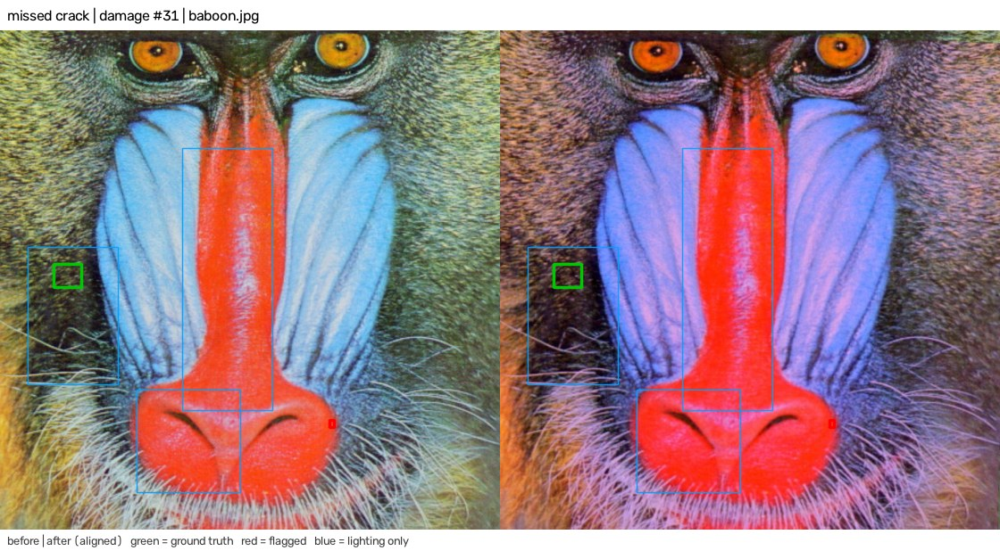
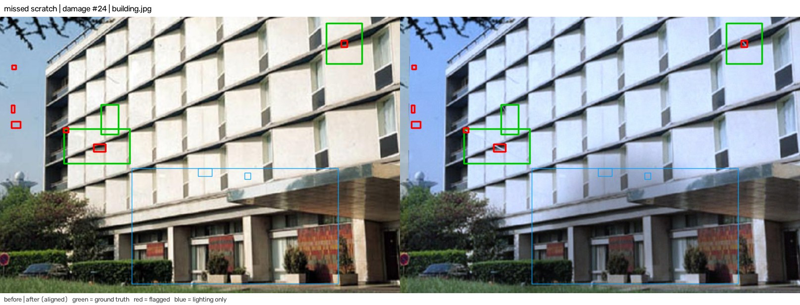
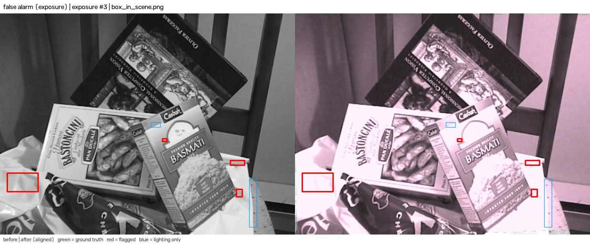

# Evaluation

This document reports how well Twice separates real damage from camera and lighting changes. Three benchmarks measure three levels:

- **Agent level** (`server/eval/agent_bench.py`): the full agent loop on 170 synthetic pairs, including the follow-up photos that the agent asks for. This is what a user gets.
- **Engine level** (`server/eval/bench.py`): the `compare` step alone on the same 170 pairs, plus registration stress, ablations, latency and the failure gallery.
- **Real photos** (`server/eval/real_bench.py`): 40 pairs of real photos from the Oxford affine sequences. Nothing in these scenes changes, so every "changed" verdict is a false alarm.

There is no set of real move-in and move-out pairs with labelled damage. Section 11 lists what that means for the numbers.

The raw results are in `docs/eval/agent.json`, `docs/eval/results.json` and `docs/eval/real.json`. The failure images are in `docs/eval/failures/`.

## 1. Summary

| Question | Result |
| --- | --- |
| Agent level, damage pairs (80 pairs, 162 defects): recall | 0.901 (146 of 162), 95% interval 0.846 to 0.938 |
| Agent level, damage pairs: precision | 0.993 (146 of 147 "changed" findings), interval 0.962 to 0.999 |
| Agent level, no-change controls (30 pairs): pairs with a false "changed" | 1 of 30 (0.033), interval 0.006 to 0.167 |
| Agent level, lighting-only controls (60 pairs): pairs with a false "changed" | 2 of 60 (0.033), interval 0.009 to 0.114 |
| Agent level, follow-up photos asked for | 0.22 per pair (24 side-step shots, 14 close-ups) |
| Real photos, nothing changed (40 pairs) | 23 judged, 17 sent back for a retake. 2 of 23 judged pairs got a false "changed" (0.087, interval 0.024 to 0.268) |
| Engine level, damage pairs: recall and precision | 0.914 and 0.931. Strict recall (box IoU of at least 0.3): 0.735 |
| Registration under rotation, scale, tilt | Accurate to 150 degrees of rotation, a 2.2 times scale change and 30 degrees of tilt. See section 5.4 |
| Latency, one before and after pair | Median 0.86 s, 95th percentile 1.06 s on a 32-thread CPU. Median 1.60 s on one thread |

The agent loop is the main result. The engine flags glare and some exposure changes. The agent then rules most of them out with a side-step photo or a veil test (section 6). On real photos, the remaining false alarms are in a tree scene and a harbour scene, where leaves and water may really move.

The evaluation also drove engine changes. Section 9 lists each change with its before and after numbers.

## 2. Method

The synthetic benchmarks generate a "move-in" image and a "move-out" image from the same source photo. The engine benchmark compares them with `Keyframe.build` and `compare` from `server/twice/vision.py`. The agent benchmark runs `Agent.on_after` and then answers every follow-up request with a new synthetic photo (section 6). The code reuses the generators in `server/eval/synth.py` by import.

Every pair derives from the seed `[20260, set id, pair index]`. Any pair can be rebuilt from its index, so the failure gallery, the ablations and the agent benchmark see identical pairs. All ablations run on the same 170 pairs as the full engine, so differences between rows are paired differences.

Run them from `server/`:

```
python eval/bench.py          # engine level, about 9 minutes
python eval/agent_bench.py    # agent level, about 1 minute
python eval/real_bench.py     # real photos, downloads the Oxford sequences on first run
```

The ten scenes are committed in `server/eval/scenes/`. A different folder can be passed to `bench.py` as the first argument. The engine benchmark runs the ablations in 12 parallel worker processes. The latency test runs first, while the machine is otherwise idle. The last full run took 513 s on the machine in section 5.5.

## 3. Dataset construction

The ten source images are OpenCV sample images: aloeL, baboon, board, box_in_scene, building, fruits, graf1, home, lena and starry_night. Each one is resized to 1100 px wide. Several are small originals that the resize enlarges, so they are smoother than a phone photo.

The "before" image is the source scene with the 8% margin cropped off. The "after" image passes through `synth.camera`. That function applies a random perspective warp of up to 2% of the short side. It then applies a random per-channel gain from 0.75 to 1.2 in 70% of pairs and a brightness offset of up to 15 levels. It ends with Gaussian noise (sigma 3) and JPEG compression at quality 70 to 91. The camera model therefore adds some colour and exposure jitter to every set below.

| Set | Pairs | What changes between before and after |
| --- | --- | --- |
| Damage | 80 | 1 to 3 defects drawn on the scene (scratch, stain, chip, crack). A cast shadow is added to 39 of 80 pairs. Camera model on top |
| No change | 30 | Camera model only |
| Exposure | 15 | Global gain of 0.55 to 0.75 or 1.3 to 1.6, then camera model |
| Colour temperature | 15 | Blue and red gains moved in opposite directions by 15% to 25%, then camera model |
| Cast shadow | 15 | One soft convex shadow from `synth.add_shadow`, then camera model |
| Specular highlight | 15 | A Gaussian white blob, sigma 3% to 7% of the short side, blended towards white at 60% to 95%, then camera model |
| Registration stress | 288 | 4 transform types, 6 strengths, 12 pairs each. Described in section 5.4 |

Defects are placed in the central 70% of the frame. The benchmark scores a defect by its ground-truth mask, which is the rendered defect layer above a threshold of 40 of 255.

## 4. Metrics

**Detection.** At engine level, a region is "flagged" when its `lighting_only` property is false. At agent level, a finding counts when its verdict is "changed". "Can't judge" findings do not count as found. Both levels use the same rule as `synth.py`:

- A ground-truth defect counts as found when at least one of its mask pixels lies inside any flagged box.
- A flagged box counts as a true positive when it contains at least one pixel of any defect mask.
- A flagged box that contains no defect pixel is a false positive.

Recall is found defects divided by all defects. Precision is true-positive boxes divided by all flagged boxes. When registration fails, every defect in that pair counts as missed. This never happened in the 170 main pairs.

**This rule is lenient.** One overlapping pixel is enough, and one box can cover two defects. The engine benchmark therefore also reports strict recall. A defect counts only if its best matching box has an intersection over union (IoU) of at least 0.3. The IoU uses the tight bounding box of the defect mask. The median IoU of all matches is 0.63.

**Controls.** For the no-change and lighting-only sets, any flagged region is a false alarm, because no damage exists. The reported rate is the share of pairs with at least one flagged region.

**Intervals.** The 95% intervals are Wilson intervals on the pair or defect counts. They treat samples as independent. They do not cover the variation from the choice of ten source images.

**Size buckets.** Size is the area of the ground-truth mask in pixels: small below 150, medium 150 to 600, large above 600. Size and defect type overlap: all stains are large and all cracks are small or medium.

## 5. Engine level

### 5.1 Damage pairs, by defect type

| Defect | Count | Recall (synth rule) | Recall (IoU at least 0.3) |
| --- | --- | --- | --- |
| Scratch | 38 | 0.947 | 0.711 |
| Stain | 35 | 0.943 | 0.857 |
| Chip | 36 | 0.944 | 0.806 |
| Crack | 53 | 0.849 | 0.623 |
| All | 162 | 0.914 | 0.735 |

Cracks are one pixel wide and have the lowest recall. The thin defect types lose most of their strict recall to box size, not to misses.

### 5.2 Damage pairs, by size and scene

| Size bucket | Count | Recall (synth rule) | Recall (IoU at least 0.3) |
| --- | --- | --- | --- |
| Small, under 150 px | 11 | 0.818 | 0.545 |
| Medium, 150 to 600 px | 95 | 0.895 | 0.674 |
| Large, over 600 px | 56 | 0.964 | 0.875 |

The small bucket holds only 11 defects, so its figure is weak. Recall is 0.929 in shadowed pairs (6 misses in 85 defects) and 0.896 in unshadowed pairs (8 in 77). The median contrast of a missed defect is 12 grey levels, against 51 for a found defect. Contrast is the mean absolute grey change over the mask, measured before the camera model and the shadow.

| Image | Defects | Recall | False positives |
| --- | --- | --- | --- |
| aloeL | 17 | 1.00 | 0 |
| baboon | 12 | 0.92 | 2 |
| board | 15 | 1.00 | 0 |
| box_in_scene | 18 | 0.78 | 2 |
| building | 17 | 0.88 | 6 |
| fruits | 16 | 0.88 | 0 |
| graf1 | 19 | 0.89 | 0 |
| home | 17 | 1.00 | 0 |
| lena | 14 | 0.86 | 1 |
| starry_night | 17 | 0.94 | 0 |

Building produces 6 of the 11 false positives. Each image appears in 8 pairs, so these counts are small.

### 5.3 Control sets

| Set | Pairs | Pairs with a flag | Rate | Flags | Pairs with a lighting region |
| --- | --- | --- | --- | --- | --- |
| No change | 30 | 3 | 0.100 | 5 | 10 |
| Lighting only (all four types) | 60 | 20 | 0.333 | 24 | 40 |
| Exposure | 15 | 1 | 0.067 | 4 | 8 |
| Colour temperature | 15 | 2 | 0.133 | 3 | 6 |
| Cast shadow | 15 | 2 | 0.133 | 2 | 14 |
| Specular highlight | 15 | 15 | 1.000 | 15 | 12 |

At engine level, every glare patch still raises a flag. The engine marks it with a veil score, and the agent resolves it with a side-step photo (section 6). The lighting label also appears in 10 of 30 no-change pairs. Those pairs have camera gain jitter, so the label is not wrong, but it cannot tell a real shadow from a gain change.

### 5.4 Registration stress

The stress transform acts on the clean source image with only noise and JPEG added. The benchmark knows the true homography, so it can check accuracy. "Registered" means `vision.match` returned a homography. "Accurate" means the median error over a 7 by 7 grid of points is at most 3 px at 960 px width. "Usable" means `compare` judged the pair. It needs at least 30% overlap and, since the retake rule in section 9, a view close to the first one: a scale change between 0.8 and 1.25 and an anisotropy below 1.3. Each cell uses 12 pairs.

Tilt is a camera pitch or yaw with a focal length equal to the image width. Scale zooms in or out with equal probability.

**Rotation (degrees in the image plane)**

| Strength | 5 | 15 | 30 | 60 | 90 | 150 |
| --- | --- | --- | --- | --- | --- | --- |
| Registered | 12/12 | 12/12 | 12/12 | 12/12 | 12/12 | 12/12 |
| Accurate | 12/12 | 12/12 | 12/12 | 12/12 | 12/12 | 12/12 |
| Usable | 12/12 | 12/12 | 12/12 | 12/12 | 12/12 | 12/12 |
| Median error (px) | 0.03 | 0.09 | 0.17 | 0.33 | 0.47 | 0.65 |

**Scale (zoom factor, in or out)**

| Strength | 1.1 | 1.3 | 1.7 | 2.2 | 3.0 | 4.5 |
| --- | --- | --- | --- | --- | --- | --- |
| Registered | 12/12 | 12/12 | 12/12 | 12/12 | 0/12 | 0/12 |
| Accurate | 12/12 | 12/12 | 12/12 | 12/12 | 0/12 | 0/12 |
| Usable | 12/12 | 0/12 | 0/12 | 0/12 | 0/12 | 0/12 |
| Median error (px) | 0.04 | 0.10 | 0.20 | 0.25 | none | none |

**Tilt (degrees)**

| Strength | 10 | 20 | 30 | 40 | 50 | 60 |
| --- | --- | --- | --- | --- | --- | --- |
| Registered | 12/12 | 12/12 | 12/12 | 7/12 | 2/12 | 0/12 |
| Accurate | 12/12 | 12/12 | 12/12 | 6/12 | 1/12 | 0/12 |
| Usable | 12/12 | 7/12 | 0/12 | 0/12 | 0/12 | 0/12 |
| Median error (px) | 0.03 | 0.04 | 0.04 | 0.04 | 0.14 | none |

**Combined** (rotation 3 to 60 degrees, zoom 1.05 to 2.2, tilt 3 to 45 degrees, rising together)

| Level | 0 | 1 | 2 | 3 | 4 | 5 |
| --- | --- | --- | --- | --- | --- | --- |
| Registered | 12/12 | 12/12 | 12/12 | 12/12 | 10/12 | 5/12 |
| Accurate | 12/12 | 12/12 | 12/12 | 12/12 | 9/12 | 5/12 |
| Usable | 12/12 | 10/12 | 8/12 | 2/12 | 0/12 | 0/12 |
| Median error (px) | 0.03 | 0.07 | 0.14 | 0.20 | 0.24 | 0.28 |

The matcher is not the limit. It registers a 2.2 times zoom accurately. The retake rule refuses to judge that pair on purpose, because a photo from a different distance shows the surface at a different resolution. On real photos this difference caused false alarms (section 7). The ghost guide in the app locks to a far tighter view, within about 1.1 times scale, so a guided photo passes the rule. The rule also covers photos that were uploaded without the guide.

The sub-pixel errors are optimistic, because the transform is an exact homography on a flat image. A real room has parallax.

### 5.5 Latency

Test machine: Intel Core i9-13900K, 32 logical threads, Windows 11, Python 3.14.7, OpenCV 5.0.0. The timer covers `Keyframe.build` for both images plus `compare`. It excludes image decoding. `Keyframe.build` runs at its defaults: 1024 px longest side and 3000 SIFT features. The machine was idle during this test, after three warm-up pairs.

| Input | Threads | Build, one image (median) | Compare (median) | Total median | Total 95th percentile |
| --- | --- | --- | --- | --- | --- |
| 924 px wide benchmark pairs (30) | 32 | 96 ms | 679 ms | 0.86 s | 1.06 s |
| 4032 px wide pairs (12) | 32 | 123 ms | 879 ms | 1.11 s | 1.29 s |
| 924 px wide benchmark pairs (30) | 1 | 363 ms | 790 ms | 1.60 s | 1.95 s |
| 4032 px wide pairs (12) | 1 | 504 ms | 1066 ms | 2.26 s | 2.47 s |

The 4032 px inputs are the benchmark images enlarged with cubic interpolation. They test the cost of the resize, not the cost of real phone detail. The object check adds NanoDet on `cv2.dnn.ENGINE_NEW`: a median of 16.3 ms per frame, against 56.5 ms on `ENGINE_CLASSIC` (`python -m eval.engines`).

## 6. Agent level

The agent benchmark runs the same 170 pairs through `Agent.on_after`. When the agent asks for a follow-up photo, the benchmark makes one:

- **Side-step shot.** A new camera position of the same scene with a larger warp (3.5% of the short side). In a glare pair, the glare patch moves to a new place on the surface, as a reflection does when the camera moves. Damage stays where it is.
- **Close-up.** A crop around the requested box, enlarged two times, with a small perspective jitter, a gain change, noise and JPEG.

| Set | Pairs | Pairs with a false "changed" | Side-step shots | Close-ups |
| --- | --- | --- | --- | --- |
| Damage | 80 | 1 false finding in total | 8 | 7 |
| No change | 30 | 1 (0.033) | 0 | 3 |
| Exposure | 15 | 1 (0.067) | 1 | 1 |
| Colour temperature | 15 | 1 (0.067) | 0 | 2 |
| Cast shadow | 15 | 0 | 0 | 1 |
| Specular highlight | 15 | 0 | 15 | 0 |
| All | 170 | | 24 | 14 |

Recall is 0.901 and precision is 0.993. The agent ends 11 findings in all 170 pairs as "Can't judge" (0.06 per pair). They count as misses in the recall figure.

The agent loses two defects against the engine (146 against 148 found) and removes nearly all false alarms (1 false "changed" finding in 80 damage pairs, against 11 flags at engine level). All 15 glare pairs end without a false "changed": the agent asks for a side-step shot, sees the bright patch move or vanish, and labels the finding "Lighting only". The veil test (section 9) sends lightened regions to the same follow-up.

The agent missed 16 defects: 8 cracks, 3 stains, 3 scratches and 2 chips. 14 of the 16 have a contrast below 25 grey levels.

## 7. Real photos

The Oxford affine sequences (Mikolajczyk et al.) photograph one scene six times with growing difficulty. Nothing in the scene changes on purpose. The benchmark compares image 1 with images 2 to 6 through the full agent, so every "changed" verdict is a false alarm. It does not answer follow-up requests, so a follow-up request ends the pair without a "changed" verdict.

| Sequence | Stress | Judged (of 5) | Pairs with a false "changed" |
| --- | --- | --- | --- |
| leuven | light | 5 | 0 |
| bikes | blur | 5 | 0 |
| trees | blur | 4 | 1 (pair 1-5) |
| ubc | JPEG | 5 | 0 |
| graf | viewpoint | 1 | 0 |
| wall | viewpoint | 1 | 0 |
| boat | zoom and rotation | 1 | 1 (pair 1-2) |
| bark | zoom and rotation | 1 | 0 |
| All | | 23 of 40 | 2 (0.087) |

The agent asked for a retake on 17 pairs. In 9, the camera stood too far from the first position for a fair comparison (the retake rule). In 8, the photos could not be matched at all. The agent asked for a follow-up photo on 10 judged pairs, mostly in the blur sequences.

Before the retake rule, 32 pairs were judged and 7 got a false "changed": trees 1-5, graf 1-4, wall 1-3, 1-4 and 1-5, and boat 1-2 and 1-3. The wall and graf pairs had a scale change of 1.2 to 1.7 and a strong tilt. The rule removed 5 of the 7. The remaining two may not be errors at all: the trees sequence shows leaves, and the boat sequence shows a harbour with water and moored boats.

The engine raised no false flag under the light change (leuven), the JPEG series (ubc) or the blur series (bikes). These are the three stresses that a re-photographed apartment meets most often.

## 8. Ablations

Each row switches off one engine step by replacing a function or object in the `twice.vision` module at run time. The engine files are not edited. Every row runs the same 170 pairs at engine level.

| Configuration | Change | Recall | Precision | FP per pair | No-change false alarm rate | Lighting-only false alarm rate | FPs in shadowed pairs |
| --- | --- | --- | --- | --- | --- | --- | --- |
| Full engine | none | 0.914 | 0.931 | 0.14 | 0.100 | 0.333 | 4 |
| Plain difference | `_tolerant_diff` replaced by `abs(a - b)` | 0.907 | 0.993 | 0.01 | 0.033 | 0.250 | 0 |
| No local normalisation | `_lnorm` returns its input | 0.216 | 1.000 | 0.00 | 0.000 | 0.250 | 0 |
| No flow refinement | DIS optical flow returns zero flow | 0.914 | 0.955 | 0.09 | 0.133 | 0.317 | 2 |
| No CLAHE | `_clahe.apply` returns its input | 0.907 | 0.942 | 0.11 | 0.133 | 0.317 | 4 |
| No clipped-pixel mask | the 7 by 7 dilation of the clipped mask returns zeros | 0.920 | 0.925 | 0.15 | 0.100 | 0.333 | 5 |
| No lighting test | `_illumination_likeness` returns 0 | 0.914 | 0.897 | 0.21 | 0.100 | 0.333 | 9 |
| Threshold z 6 (sensitivity, not an ablation) | `z_thresh=6` | 0.951 | 0.644 | 1.06 | 0.333 | 0.533 | 34 |
| Threshold z 12 (sensitivity, not an ablation) | `z_thresh=12` | 0.883 | 1.000 | 0.00 | 0.033 | 0.267 | 0 |

The default threshold is z 9. One defect is 0.006 of recall. One false positive is 0.0125 of FP per pair. Differences of one or two defects, or of two to three false positives, are within noise.

- **Local normalisation is essential.** Without it, recall falls to 0.216.
- **The lighting test no longer costs recall.** In the first evaluation, switching it off recovered 8 thin defects inside shadows. With the sharp-edge test from section 9, recall is the same with and without it (0.914). The test still removes 5 false positives in shadowed pairs.
- **The plain difference beats the tolerant difference on this synthetic data.** It has nearly the same recall and far fewer false positives. The synthetic warps are exact homographies with almost no residual misalignment, so the tolerance has little to absorb. The tolerant difference is kept because real handheld photos have parallax. The real-photo benchmark has no damage, so it cannot settle the question. A labelled real set can.
- **Flow refinement, CLAHE and the clipped-pixel mask show no clear effect.** The differences are within noise. These steps address problems that this dataset barely contains.
- **The threshold trades recall for precision smoothly.** Moving from z 12 to z 6 raises recall from 0.883 to 0.951 and cuts precision from 1.000 to 0.644.

## 9. What the evaluation changed

The first evaluation exposed faults in the engine. The changes below fix them. The results above use the fixed engine.

| Change | Problem it fixes |
| --- | --- |
| Exposure-matched border fill | Pixels outside the warped photo were filled from the move-in photo without an exposure match, so exposure changes made strips along the border |
| Sharp-edge test for lighting | The lighting test hid thin dark lines inside shadows. A shadow changes brightness smoothly and a scratch has a sharp edge, so a region with a sharp residual no longer counts as lighting |
| Chroma noise floor | Near-grey regions had a tiny chroma spread, so a small colour change scored very high |
| Veil test | Glare lifts a surface towards white in proportion to its distance from white. The test fits this model and sends a good fit to the side-step follow-up |
| Retake rule (`_same_view`) | A move-out photo from a different distance or angle shows the surface at a different resolution, and texture then reads as change |

The first four changes were measured together on the same pairs:

| Level | Metric | Before | After |
| --- | --- | --- | --- |
| Engine | Recall | 0.858 | 0.914 |
| Engine | Precision | 0.880 | 0.931 |
| Engine | Exposure pairs with a flag | 7 of 15 | 1 of 15 |
| Engine | No-change pairs with a flag | 5 of 30 | 3 of 30 |
| Agent | Recall | 0.852 | 0.901 |
| Agent | Precision | 0.972 | 0.993 |
| Agent | Lighting-only pairs with a false "changed" | 0.30 | 0.033 |

The retake rule was measured alone. It cut the real-photo pairs with a false "changed" from 7 to 2 and left every synthetic agent result unchanged.

One experiment failed. Matching the sharpness of the two photos before the difference gave 8 false pairs on real photos and broke the glare check on the car sample. It was reverted.

## 10. Failure gallery

Each image shows the before frame on the left and the aligned after frame on the right. Green boxes are ground-truth defects. Red boxes are flagged regions. Blue boxes are regions the engine labelled lighting only. A found defect shows a red box over its green box. The gallery shows engine-level output and picks the first failure of each type, so it shows typical failures, not the worst ones.

### Missed defects


**Missed chip, graf1 pair 16.** The chip has a contrast of only 11 grey levels against a light grey surface, so it is nearly invisible. The other two defects in the pair were found. The agent also misses it.



**Missed crack, baboon pair 31.** A thin crack in fur, after a colour shift. The crack lies inside a large region that the engine labelled as lighting, because the whole fur area changed colour smoothly. The agent asks for a close-up and still cannot see it.



**Missed scratch, building pair 24.** The after photo is much brighter, and the scratch sits on a pale wall panel whose contrast the brightening flattens. The two other defects in the pair were found. The small red boxes on the left edge are false positives on sky and branches.


**Missed stain, graf1 pair 26.** A large stain with a contrast of 8 grey levels, which is below the engine noise floor.

### False alarms


**Glare flagged at engine level, aloeL specular pair 0.** The white veil removes colour from the green leaf, so the chroma score is 13.8. The agent resolves this pair: it asks for a side-step shot, the patch moves, and the finding becomes "Lighting only".


**Small flag in a shadow pair, box_in_scene pair 13.** A 10 by 13 px region with a structure score just above the threshold. Nothing in the scene changed there. The agent removes it.


**Two small flags after a colour shift, baboon pair 1.** The regions are 10 by 5 and 12 by 7 px on high-contrast fur texture. A small texture mismatch survives the colour compensation. The agent asks for close-ups and removes both.



**Flags after an exposure change, box_in_scene pair 3.** The after photo is much brighter. The white plastic bag at the left clips to pure white and loses its texture, so the largest flag lies on it. The agent asks for a side-step shot and a close-up, but one false "changed" remains. This is one of the 3 agent-level false alarms in the control sets.

## 11. Limitations

- **There is no labelled real damage.** The synthetic defects are drawn shapes with fixed tones. Real scratches, stains and chips have texture, depth and soft edges. The real-photo benchmark measures false alarms only.
- **The synthetic follow-up photos are simple.** The side-step shot is a larger warp of the same flat image, and glare moves by construction. A real reflection moves with surface shape and camera position. The agent results for glare are therefore optimistic.
- **The real set is small and not a room.** The Oxford sequences are 8 scenes and 40 pairs. They include blur, JPEG, light and viewpoint stress, but no wall, floor or car panel.
- **The scenes are few and small.** There are 10 synthetic source images, several enlarged from 512 px or less. Each one appears in 8 damage pairs.
- **The matching rule is lenient.** One overlapping pixel counts as a hit. Strict recall at engine level is 0.735 against 0.914. A report that says where the damage is should quote the strict figure.
- **Statistical power is low in places.** The small-defect bucket has 11 defects. The control sets have 15 or 30 pairs, so a rate of 0.033 has an interval up to 0.167.
- **The engine was tuned on this generator.** The fixes in section 9 were measured on these pairs. Treat the synthetic numbers as a development benchmark, not a clean held-out test. The real-photo numbers were not used to tune any threshold except the retake rule, which uses the guide's own limits.
- **Latency is for a desktop CPU.** A phone or a small server will be slower.
- **No human evaluation.** The benchmark does not measure whether the reported regions, captions or signed report help a person.

The next step is a collected set of real move-in and move-out pairs with labelled damage, photographed with the ghost guide.
