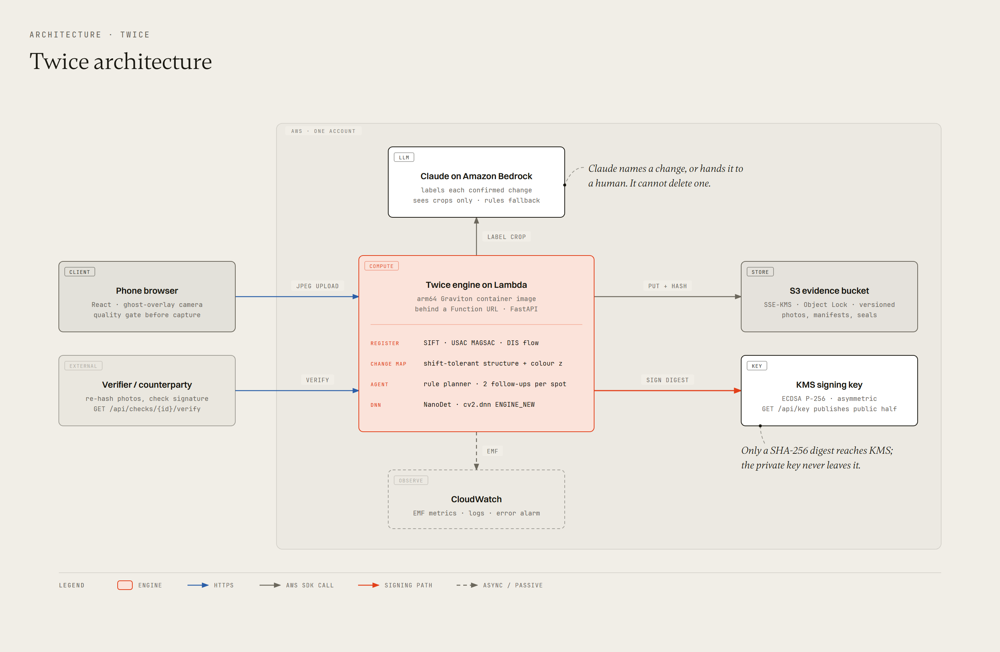
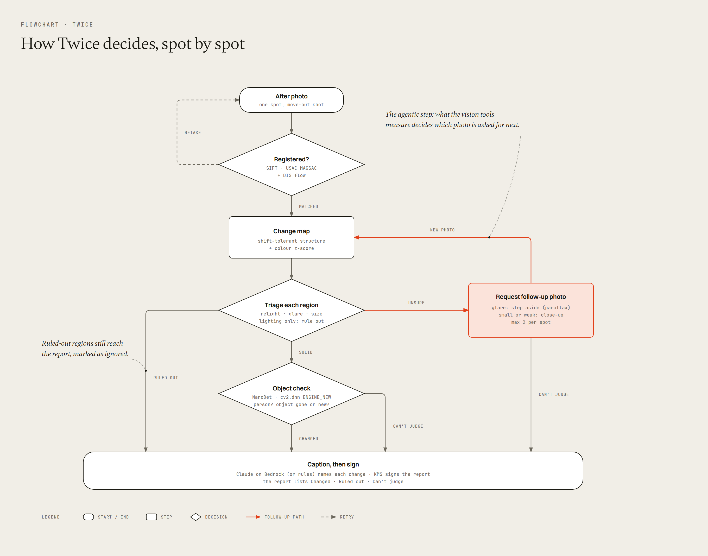

# Twice: technical report

OpenCV AI Competition 2026. Repository: this repo. Live endpoint: see README.

## 1. Problem

Rental companies and landlords document the condition of a car or an apartment with detailed photos and, increasingly, with AI scanners. Renters rarely have comparable evidence. A Hertz renter received a $440 bill for a one-inch scuff found by an airport scanner, with no human review before the bill went out ([The Drive](https://www.thedrive.com/news/this-is-what-happens-when-hertzs-ai-scanner-finds-damage-on-your-rental)). A House subcommittee chair has asked Hertz for a briefing on the system ([House Oversight](https://oversight.house.gov/release/mace-investigates-use-of-artificial-intelligence-for-car-rental-damage-assessments)). In apartments, deposit disputes follow the same pattern: the landlord has move-out photos, and the tenant has a few unmatched phone shots.

Unmatched photos fail as evidence for three reasons:

1. They are taken from different angles, so nobody can say whether a mark is new.
2. Light changes between visits. Shadows, lamps and reflections look like damage in a naive comparison.
3. Nothing proves the photos were not edited or swapped later.

Twice addresses all three. It guides the second photo to the angle of the first, separates real change from lighting, and signs the photos and findings.

## 2. Users and flow

- **Renter** (primary user). Shoots three to six spots at move-in. The shutter enables only when a photo is sharp, lit and textured enough to match later. The set is sealed with a signature before any move-out photo exists.
- **Renter at move-out.** A ghost of each move-in photo floats over the camera. Live frames are matched to the reference, and the app tells the user how to move ("Pan left", "Move closer"). It shoots on its own when the view locks.
- **Counterparty** (landlord, fleet manager, small-claims reviewer). Receives a link to the report. The report shows aligned pairs, numbered findings with measured evidence, the SHA-256 of every photo, two signatures, and a list of what the report cannot prove. A verify endpoint re-hashes every stored photo.

## 3. System

One container serves the React app and the FastAPI backend. On AWS it runs on Lambda (arm64, Graviton) behind a Function URL, with the Lambda Web Adapter. The same image runs locally with `docker run`.

| Concern | Local | AWS |
|---|---|---|
| Photo and manifest storage | `./data` | S3, SSE-KMS, versioning, Object Lock (governance, 1 day), 30-day expiry |
| Manifest signing | Ed25519 key on disk | KMS asymmetric key, ECDSA P-256, `Sign` with a SHA-256 digest |
| Finding labels | Rule-based labels | Claude on Amazon Bedrock, JSON-schema output |
| Metrics | JSON log lines | CloudWatch Embedded Metric Format, error alarm |

The browser shrinks every photo to at most 2400 px before upload, which keeps requests under the 6 MB Function URL limit.

## 4. Computer vision

All image analysis uses OpenCV 5.0.0 (`opencv-contrib-python-headless`). The engine is `server/twice/vision.py`.

### 4.1 Capture quality gate

Each preview frame is scored for brightness, clipped highlights, sharpness (variance of the Laplacian) and the number of SIFT features on a CLAHE-equalised image. A photo with fewer than 80 features or a sharpness below 60 is rejected, because it cannot be registered reliably months later.

### 4.2 Guided re-capture

The move-in photo is stored with SIFT keypoints at two resolutions: 1024 px for analysis and 480 px for live guidance. Each live frame is matched with a FLANN matcher and Lowe's ratio test (0.75). A homography is fitted with `cv2.USAC_MAGSAC` (threshold 3 px, at least 25 inliers) and checked for plausibility (area ratio, convexity, corner spread). The homography is decomposed into a shift, a scale and a roll, which drive the on-screen instruction. The ghost overlay is warped in CSS with a `matrix3d` built from the projected corners. The app captures automatically after three consecutive aligned frames with an alignment score above 0.72.

### 4.3 Registration

The move-out photo is matched to the move-in photo the same way, then warped with `warpPerspective`. Pixels outside the warped area are filled from the move-in photo so they cannot produce change. Dense `DISOpticalFlow` (medium preset) on the aligned pair corrects residual parallax and lens differences. The flow is clamped so it cannot "explain away" a real change by moving pixels far.

### 4.4 Change map

A naive absolute difference flags every edge after a sub-pixel shift, every exposure change and every shadow. The change map is built in four steps:

1. Both images are converted to Lab and blurred with a Gaussian (σ = 1).
2. The L channel is locally normalised: subtract a local mean and divide by a local standard deviation (σ = 12). This removes exposure and gain changes.
3. **Shift-tolerant difference.** Each pixel is compared with the other image's min/max envelope over a small window (`dilate` / `erode`), in both directions. A value inside the envelope counts as zero. This removes edge ghosts from sub-pixel misalignment but keeps new texture.
4. **Robust z-score.** The difference is standardised by its noise level. The median absolute deviation collapses to zero for a tolerant difference, so the scale falls back to the 95th-percentile tail.

A pixel is a candidate when its z-score exceeds 9 and an absolute gate also passes (L difference above 9 after gain compensation, or a chroma difference above 6). Clipped highlights and a thin border band are masked. Speckle is removed with a morphological opening, nearby fragments are grouped by dilation, and overlapping boxes are merged so one physical mark is one finding.

### 4.5 Lighting and reflections

For every region, two measurements separate light from damage:

- **Illumination likeness.** A smooth multiplicative light field is fitted to the log ratio of the two images. If it explains more than 80 % of the change and the chroma shift is small, the region is lighting only. Large smooth regions (shadows, lamps, sun patches) are also reported as separate "lighting only" findings, so the report can show what was ignored.
- **Brightening.** The share of pixels that newly reach near-white (above 250 after gain compensation). A reflection appearing or vanishing changes this share. It cannot be resolved from one photo, so it triggers a parallax request (section 5).

### 4.6 Objects on the new DNN engine

NanoDet-Plus (416 × 416, from opencv_zoo) runs on both aligned photos with `cv2.dnn.readNetFromONNX(path, engine=cv2.dnn.ENGINE_NEW)`. On the development CPU, the new engine runs the model in a median of 16.3 ms per frame against 56.5 ms on `ENGINE_CLASSIC` (100 runs, `python -m eval.engines`). The two engines return the six output tensors in different orders, so the decoder pairs them by shape instead of by index.

## 5. Agent

The agent (`server/twice/agent.py`) is a rule planner. Its tools are OpenCV measurements, and every decision is logged with the measurement that caused it. The trace is shown in the app and stored in the signed report. Each spot has a budget of two follow-up photos.

| Tool | Trigger | Next action |
|---|---|---|
| `register` | every move-out photo | Fewer than 25 inliers or an implausible homography: ask for a retake. |
| `relight_check` | smooth light field explains the change, low chroma | Rule out as lighting. |
| `glare_check` | near-white share changed by more than 5 % | Request a side-step (parallax) photo. If the change vanishes, it was a reflection. If it persists at the same surface position, it is damage. |
| `relight_check` (soft) | shadow-like edges but a colour shift | Request a close-up. |
| `size_check` | small region (under 0.15 % of the view) with a weak peak | Request a close-up. The close-up is cropped around the box, upscaled up to 2x and compared again. |
| `object_check` | any finding not ruled out | A person over the finding in only the move-out photo: "can't judge". An object present in only one photo: label it "missing" or "new". |
| `budget` | no follow-ups left | Mark unresolved findings "can't judge". |
| `caption` | confirmed changes | Claude on Bedrock names the change, or flags it for a human. Without Bedrock, rule labels. |

This satisfies the Agentic Vision criterion directly: a vision measurement (the brightening share, the region size, the soft-edge test) decides whether the agent asks for another photo, and which kind.

The language model is deliberately weak. It receives the crops of a finding and returns a short label and a `needs_human` flag. If it cannot name the change, the finding gets a note for a human reviewer. It cannot add, delete or change a finding's verdict. If Bedrock fails, the rule label is used. Geometry and measurement own every verdict.

## 6. Evidence and verification

- Every uploaded photo is hashed with SHA-256 on arrival and stored under its spot.
- **Seal 1** (move-in): a canonical JSON manifest (sorted keys, no whitespace) lists every move-in photo hash and time. It is signed before any move-out photo can be added; the API returns 409 for new spots after sealing.
- **Seal 2** (report): a manifest over all photos, follow-ups, findings, evidence and agent traces, plus the digest of seal 1.
- `GET /api/checks/{id}/verify` re-reads every stored photo, recomputes its hash, recomputes both manifest digests and checks both signatures with the public key. The test suite edits a stored photo and expects verification to fail.

## 7. Evaluation

Summary here; full tables, ablations, latency and the failure gallery are in [evaluation.md](evaluation.md).

EVAL_SUMMARY

## 8. Responsible operation

- **Three answers, never hidden.** Every difference ends as Changed, Lighting only or Can't judge, and all three appear in the report.
- **A human reviews.** The report says that findings are measurements, not legal conclusions.
- **Limits are printed.** The report states that it covers only the photographed spots, that times come from the server clock, and that a valid signature does not prove a photo shows what it claims.
- **Data minimisation.** No accounts. Photos expire after 30 days by default. The bucket blocks public access and denies non-TLS requests.
- **Least privilege.** The Lambda role can only read and write its bucket, sign with its key, and invoke the configured Claude model.
- **Cost.** One analysis is one Lambda invocation of about one second at 3 GB, plus one short Bedrock call per confirmed change.

## 9. Limitations

- The evaluation uses real photos with synthetic damage. There is no set of real move-in and move-out pairs yet.
- Strong parallax (a door that moved, a chair pushed aside) is reported as change. That is correct for the renter but can look noisy.
- Very low texture surfaces (a freshly painted white wall) can fail the quality gate or registration. The app asks for an edge or a corner in the frame.
- Server timestamps prove when the server received a photo, not when it was taken. A trusted-time service or a counterparty acknowledgment at move-in would close that gap.
- NanoDet knows the 80 COCO classes. Most damage is not an object, so `object_check` mostly labels missing furniture and items, and catches people in frame.

## 10. Future work

- A counterparty acknowledgment: the landlord or agent co-signs the move-in seal on the spot.
- A real-photo benchmark collected with volunteers across apartments and cars.
- On-device guidance with opencv.js 5 to remove the network round trip from the ghost overlay.
